<div align="center">


# 記憶模糊（FadingMemory）

**讀一次紙條，憑記憶辦妥所有事情。**
給長者練習記憶力的網頁遊戲 ── 手機打開就能玩，沒網路也能玩。

### 👉 [立即開始玩](https://weichenglin0215.github.io/FadingMemory/) 👈

目前版本 **V1.52.0**　｜　**187 款**小遊戲　｜　免安裝、免註冊　｜　[更新歷程與重點](GITHUB主要更新歷程.md)

</div>

> 本遊戲是記憶力練習與腦力娛樂，**不是醫療診斷或治療工具**，不做任何醫療效果宣稱。

## 目錄

- [為什麼做這個遊戲（開發初衷）](#為什麼做這個遊戲開發初衷)
- [三個入口怎麼玩](#三個入口怎麼玩)
- [系統特色](#系統特色)
- [187 款小遊戲介紹](#187-款小遊戲介紹)
- [怎麼開啟、怎麼裝在手機上](#怎麼開啟怎麼裝在手機上)
- [開發工具](#開發工具)
- [開發過程](#開發過程)
- [給開發者的參考資料](#給開發者的參考資料)

---

## 為什麼做這個遊戲（開發初衷）

- 記憶力退化最早影響的，往往是**日常生活**：記不得要搭幾號公車、要去哪裡辦事、剛剛說好要做什麼。
- 市面上的記憶遊戲多半是翻牌、背數字，離生活很遠，長者不容易持續玩。
- 所以我們把練習包成「**今天有一堆事要辦**」的熟悉情境：先看一張辦事紙條，**看完就燒掉**，接著只能憑記憶一件一件把事情辦妥。
- 玩的時候不是只有「記」：還要**算、比、判斷、反應**。後來又陸續做出一百多款短短幾分鐘就能玩完一關的小遊戲，讓玩家每天都有新鮮的東西可以挑戰。
- 設計原則：**字大、操作簡單、不需要註冊、手機與電腦畫面一致**；答錯不會被責備，而是告訴你「為什麼會錯」。

適合想主動練習腦力的**中高齡長者**，也適合家人一起玩、比比看誰厲害（「阿嬤都比你厲害」就是這樣來的）。

## 三個入口怎麼玩

打開遊戲後，主選單有三個入口：

### 1. 明明還記得...（記憶挑戰）

先**自己挑一個故事主軸**：🎂 生日、🧳 旅遊、🏥 看病、🍽️ 聚餐。一個主軸貫穿 **8 關**，題數從 4 題一路增加到 36 題。

1. **看紙條**：不限時間，可以翻回上一頁。第 1 關是精簡條列，之後逐關變成口語長文（約 40 字 → 565 字），裡面有跨頁更改、容易混淆的描述、以及「看起來像重點、其實不會考」的閒聊。
2. **燒掉紙條**：按下「看完了，燒掉」才開始答題，之後不能再偷看。
3. **答題**：答對自動跳下一題；答錯會標出正確答案，並用一句話說明為什麼會錯。
4. **結果頁**：答對率，加上「**最容易被哪一種混淆騙到**」（張冠李戴、新舊混淆、似曾相識、常理陷阱、拼湊組合、數字相近、否定遺漏、順序顛倒、差一點點、計算失誤）。

特色：

- **每一局題目都不同**：號碼、台北真實路名、店名、物品、人物、顏色全都會換，沒辦法死背答案；每一關都有明確的日期、時間和有名字的角色（女兒淑芬、孫子小寶…），**連日期本身也會考**。
- **回想題故意打亂思緒**：第 5～8 關會突然插進前面關卡的題目（標示「回想第 N 關」）。
- 重玩同一關、重新整理，題目不變（讓你把正確答案記牢）；按左上「←」回主選單再進來，才會換一局新的。

| 故事主軸 | 要記的事 |
|---|---|
| 🎂 生日 | 誰在哪一天過生日、買什麼禮物、訂什麼蛋糕、怎麼布置、時間臨時改了；會問生日是哪天、星期幾、還有幾天。 |
| 🧳 旅遊 | 一局抽 3 個台灣真實景點；從出發日期換算季節、決定帶哪種衣服；訂房、交通、人數、景點特色、美食、伴手禮、突發事件。 |
| 🏥 看病 | 醫院、科別、醫師、診間、掛號號碼；看診與回診日期（「兩個禮拜後回診」要自己算）；藥的樣子與吃法、空腹、費用。 |
| 🍽️ 聚餐 | 聚餐日期與餐廳（一局兩家候選，後來一通電話會改訂另一家）、參加人員（含臨時加入）、座位安排、菜色與烹飪方式、忌口、飲料、結帳與每人分攤、散場誰搭誰的順風車回家。 |

### 2. 秒反應（小遊戲大全，共 187 款）

按下去會跳出「**選一個想玩的遊戲**」的全螢幕畫面：手指上下拖曳瀏覽縮圖，點一款就能玩。每款遊戲都有簡短的玩法說明、**世界前 30 名排行榜**，可以無限次重玩、累積自己的最佳紀錄。完整遊戲列表在[下面](#186-款小遊戲介紹)。

### 3. 出去走走（3D 城市）

在 3D 城市裡走動、搭公車（236／758／52 路）、逛百貨公司、騎 UBIKE，照紙條的路線把事情辦完回家。

- 左下搖桿（鍵盤：方向鍵／WASD）：往上前進、往下後退、左右轉彎。
- **面對**物件並靠近，右下會出現互動鍵（搭電梯、等公車、開門…）；也可以直接點 3D 物件。
- 左上 ≡ 是暫停選單；開場說明、紙條、對話框、公車廣播都會用語音念出來。

## 系統特色

這些功能是所有遊戲共用的（每個功能是哪個版本加入的，見[更新歷程](GITHUB主要更新歷程.md)）：

| 特色 | 說明 |
|---|---|
| 🧓 **長者友善** | 字體大、按鈕大、一個畫面一件事；固定 500×850 舞台，手機、平板、電腦畫面完全一致。 |
| 🎯 **玩家自己挑** | 故事主軸、小遊戲都是自己選，不是亂數決定；選單有分類頁籤（記憶、視覺、反應、數字、邏輯、手感、目測）與「最近玩過」，最右邊還有「搜尋」，輸入遊戲名稱（只打一部分也行）就只留下符合的遊戲。 |
| 🏆 **世界排行榜** | 每款遊戲都有前 30 名；成績進榜會跳恭喜、放煙火。 |
| 👤 **玩家帳號** | 暱稱全站唯一＋4 位數密碼；換手機登入，成績與個人最佳都跟著走。不想登入也能玩。 |
| 🪜 **記住你的程度** | 闖關遊戲會記住最佳關卡，下次從「最佳關卡 − 4」開始，不用每次從第 1 關爬；失敗了可以從前幾關接著玩。 |
| 👵 **阿嬤都比你厲害** | 你創的紀錄被別人超越時，進選單會跳出提醒，點一下就能再去挑戰。另外還有「來都來了，快開一局」「從從容容、游刃有餘」兩種推薦彈窗輪流出現。 |
| ⭐ **五星評價與意見** | 結算畫面可以給遊戲評星星、打字寫「我有話要說」，開發者依玩家意見持續調整遊戲（很多遊戲的改版就是這樣來的）。 |
| 📲 **加到主畫面、離線也能玩** | 可以像 App 一樣裝在手機上；沒網路時照樣玩，排行榜成績會等有網路再補送。 |
| 🔊 **8-bit 音效與音樂** | 所有音效與結算背景音樂都是即時合成的，右上角喇叭可以靜音。 |
| ☝️ **操作提示** | 第一次進需要操作的遊戲，會有手指圖示指在第一關的正確位置。 |
| 🌀 **干擾用動態背景** | 判斷長度、角度、位置、人數的幾款遊戲（錯覺大師、掛畫、面積一樣大、容量一半、畫成直角、一半的人、數線落點、照抄曲線、照號切水果…），背景會墊一層很淡、慢慢移動或旋轉的花紋（條紋、圓圈、螺紋、棋盤、六角形），略為干擾眼睛、提高難度。每款遊戲自己決定從第幾關開始出現；判定、揭曉答案時會先收起來，不會擋住題目。 |
| 🧮 **錯一次就結束、難度慢慢增加** | 闖關遊戲沒有「機會」的概念，成績＝你撐到第幾關；不限時的邏輯遊戲（數獨等）則是填錯不會結束；少數思考遊戲（保存期限、水果進出貨、疊箱子、形色不相鄰、抱著量體重、六角著色）每一關有時間條，超過時間就失敗。 |
| ⚙️ **漢堡選單** | 主選單左上角：設定（暱稱、音效）、成績（每款遊戲你的世界名次與個人最佳）、安裝與離線管理。 |
| 🔄 **自動更新** | 有新版本時，玩家下次打開（或切回頁面）自動拿到最新檔案。 |

## 187 款小遊戲介紹

> 下面每一格的圖片，就是遊戲選單裡看到的縮圖（遊戲開始約 3 秒的真實畫面）。
> 玩法文字取自各遊戲開始前的「玩法說明」，只摘錄前面幾句；完整規則進遊戲就看得到。

**快速跳到分類：** [🧠 記憶](#-記憶類遊戲22-款)　[👀 視覺](#-視覺類遊戲34-款)　[⚡ 反應](#-反應類遊戲29-款)　[🔢 數字](#-數字類遊戲39-款)　[🧩 邏輯](#-邏輯類遊戲29-款)　[✋ 手感](#-手感類遊戲19-款)　[📏 目測](#-目測類遊戲15-款)

### 🧠 記憶類遊戲（22 款）

看一眼、記起來、再憑印象答。從點燈位置、杯子裡的球，到記住小雞、旗子和陷阱的位置，直接練「短期記憶」。

| 縮圖 | 遊戲 | 玩法與特點 |
|:---:|:---:|---|
| 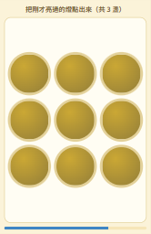 | **點燈記憶** | 燈板上有幾盞燈會同時短暫亮起，記住它們的位置。熄滅後，把剛才亮過的燈一個一個點出來。全對就多亮一盞，點錯或超時就結束，看你最多記得住幾盞！ |
| 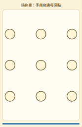 | **解鎖圖案** | 像手機的圖案解鎖：先看一次示範的連線，再用手指在點陣上畫出同樣的圖案，不能重複經過同一個點。圖案一關比一關長，看你最長能記住幾個點！ |
| 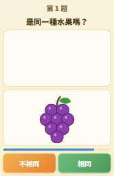 | **相同嗎？** | 先看上面一格的東西，它消失之後，下面一格會出現第二個東西。判斷兩個是不是一樣，點「相同」或「不相同」。會有水果、圖形、數字和算式，越後面越像、越快，答錯一次就結束！ |
| 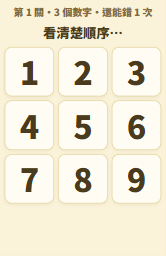 | **倒背數字** | 九宮格會依序亮起幾個數字，請「倒著順序」把它們按回去，例如亮 1、2、3 就按 3、2、1。每過兩關多一個數字、亮得越來越快，按錯一次就結束，看你能闖到第幾關！ |
| 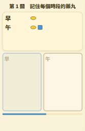 | **分藥盒** | 先看吃藥單，記住每個時段有哪些顏色、什麼形狀、幾顆藥丸。單子收起來後，上面會出現一堆藥丸（還混了顏色或形狀不一樣的干擾藥丸，數量也故意多放），用手指把正確的藥丸拖曳到下面藥盒的格子，按「好了」。 |
| 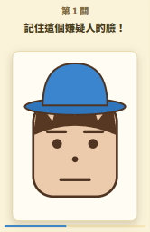 | **目擊證人** | 先看一張嫌疑人的臉，記住他的特徵。臉收起來之後，從一排人裡點出剛才那一個。越後面，大家越像，選錯一次就結束！ |
| 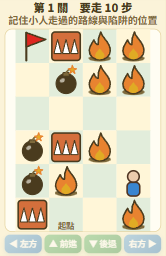 | **照著走** | 先看小人示範走到有旗子的地方，要記住彎來彎去的路線和陷阱的位置。3 秒倒數後，旗子和陷阱都消失，小人回到起點。用「左方、前進、後退、右方」按鈕走，或用手指拖著小人畫路線（放開手指才判定），步數要跟示範一樣。 |
| 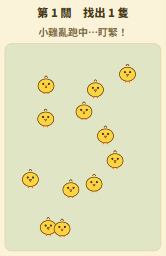 | **找回小雞** | 先記住頭上有閃爍藍色星星的小雞。星星消失後，小雞會到處亂跑，碰到彼此會彈開。等牠們停下來，直接點剛才有星星的那幾隻：只有星星小雞點得到，點到別的地方就失敗了！越後面小雞越多、跑得越快！ |
| 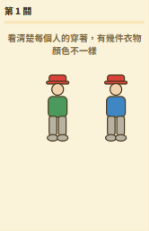 | **路人走過** | 幾個人會從畫面右邊走進來、左邊走出去，他們身上有幾件衣物的顏色不一樣，其他衣物都是灰色。他們走完之後，會問你「第幾個人的哪一件是什麼顏色」。答錯或來不及就結束，看你能過幾關。越後面人越多、顏色不一樣的衣物越多、走得越快！ |
| 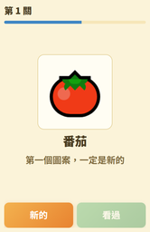 | **這個看過嗎** | 每一關出現一個食物圖案和名稱。判斷它是「新的」，還是前面的關卡「看過」了。新圖案和看過的圖案會混在一起出現。前幾關的圖案一定都是新的（第 1 關只能按「新的」），之後才考你看過沒有。 |
| 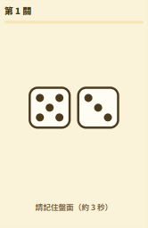 | **骰子少一點** | 先記住盤面上的骰子，接著全部蓋住 3 秒，再亮出來時有幾顆骰子的點數被換掉了（只差 1 點），把它們點出來。一開始 2 顆骰子，之後每關多一顆，被換掉的也會越來越多。點錯或來不及就結束，看你能過幾關。 |
| 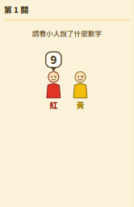 | **誰說的** | 幾個不同顏色的小人輪流說話，頭上的泡泡會出現一個數字。說完後會問某個顏色的小人說過哪些數字，請用下面的數字按鈕依序按出來。按錯或來不及就結束，看你能過幾關。越後面，小人越多、說的數字也越多！ |
| 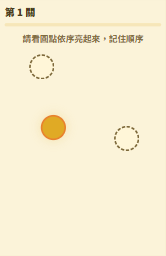 | **倒著點** | 畫面上有幾個圓圈，圓圈會一個一個依序亮起來。亮完之後，請「倒著」把它們依序點回去：最後亮的最先點。點錯或來不及就結束，看你能過幾關。越後面，圓圈越多、亮得越快！ |
| 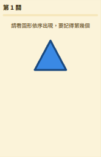 | **第幾個出現** | 畫面中央會依序閃現幾個圖形（同一個圖形可以重複出現），閃完後會問「第幾個出現的是哪一個圖形」，請點出下面的答案。後面還會出現同一種形狀、不同顏色的圖形。答錯或來不及就結束，看你能過幾關。 |
| 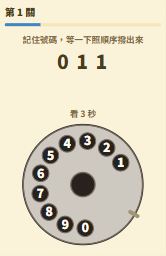 | **轉盤電話** | 上方會閃過一組電話號碼，然後收起來。下面是一台老式轉盤電話：手指伸進數字的洞，順時針畫圈拉到金屬擋片，放手，轉盤會自己轉回來，這樣就撥了一個數字。照順序把號碼撥完，撥錯一碼就結束。 |
| 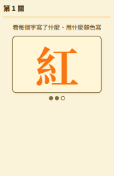 | **字的顏色** | 一個字一個字閃過：每個字是一種顏色的名字，卻用另一種顏色寫（例如用藍色寫的「紅」）。閃完之後會問一個問題：「第幾個字寫的是什麼字？」或「第幾個字是什麼顏色寫的？」，點下面的顏色按鈕。 |
| 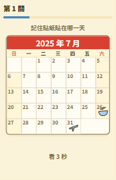 | **記行事曆** | 一個月的月曆，上面貼了幾張小貼紙（牙醫、生日蛋糕、回診、繳費單…）。3 秒後貼紙會消失，但下方會有一堆同樣的圖案亂跳、一直閃爍 2 秒來干擾你，然後才問你：「牙醫是哪一天？」點月曆上的日期。 |
| 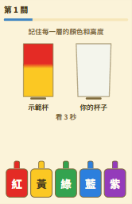 | **照樣調一杯** | 吧台先展示一杯分層的漸層飲料（各層顏色不同、高度也不同），幾秒後收走。照記憶一層一層調出一樣的：按住那個顏色的瓶子倒、放手停，再換下一個顏色，由下往上、顏色順序要對（按錯瓶子就結束）。 |
| 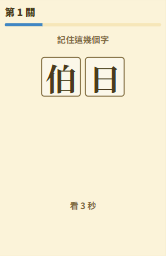 | **看過的字** | 畫面會閃出幾個字，幾秒後收起來。接著出現一個字格，點出剛才看過的那幾個字，點完按「好了」。小心：字格裡其他的字全都是長得很像的形近字（看過「侍」，字格裡就有「待、持、特、恃」），要看清楚每一筆。少點、多點、點錯都算錯。 |
| 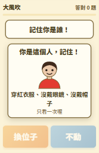 | **大風吹** | 一開始會告訴你你是誰：衣服的顏色、有沒有戴眼鏡、有沒有戴帽子（只看 3 秒）。然後口令一句一句出現，例如「大風吹，吹戴眼鏡的人！」——口令說的是你，就點「換位子」，不是在說你，就點「不動」。 |
| 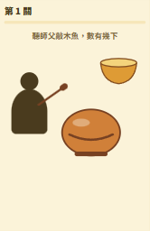 | **敲幾下** | 寺廟的木魚。師父先敲一段（快速的節奏，分成好幾組，組與組之間停頓長短不一），木魚旁邊沒有數字。師父另一手會不定時敲銅缽（「噹——」，可能連續好幾下），銅缽的聲音不算。 |
| 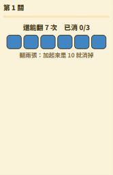 | **翻牌湊十** | 數字牌蓋著排成方陣（數字是 1～9）。每次翻兩張：加起來是 10 就消掉；不是就蓋回去。全部消完就過關。翻牌的次數有上限，畫面上會寫「還能翻幾次」。 |

### 👀 視覺類遊戲（34 款）

找不同、辨顏色、看穿錯覺。差異會一關比一關小，考的是專注力與觀察力。

| 縮圖 | 遊戲 | 玩法與特點 |
|:---:|:---:|---|
| 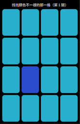 | **大家來找碴** | 4×4 共 16 個方格，其中 15 格顏色完全一樣，只有 1 格的顏色略有不同（色相、彩度或明度）。點下你覺得不一樣的那一格；答對就進下一關，差異會越來越小，越後面要越仔細看。答錯就結束，比比看能撐到第幾關。 |
| 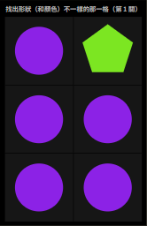 | **形形色色** | 畫面會被分成一格一格，裡面幾乎所有格子都長得一模一樣，只有一格不一樣。前面的關卡形狀和顏色都不同，顏色很鮮豔；越後面顏色越淡、差異越小，第 15 關起變成黑白，只剩形狀不同。圖案會從符號、數字，慢慢變成筆畫越來越多的字。 |
|  | **色不異空** | 畫面左右各有一個色塊，中間隔著一條黑色長方形。左邊的色塊顏色不會變，右邊的色塊顏色會一直在變（每一局只有色相、彩度、亮度其中一種在變）。用眼睛仔細看，覺得兩個色塊的顏色「完全相同」的那一刻，馬上點擊畫面！ |
| 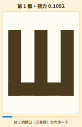 | **E視力檢查** | 畫面中央有一個「E」字，開口（三隻腳）朝哪個方向，就用手指往那個方向滑一下（只有上下左右）。每換一次方向，E 就縮小成 90%，只要錯一次就結束，看你能看清楚多小的 E！ |
| 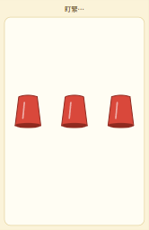 | **球在哪杯** | 球藏在其中一個杯子下面。杯子像時鐘一樣圍成一圈。先看清楚球在哪裡，杯子蓋回後會穿過圓圈中間，成對換到對面的位置（出發的時間還會稍微錯開），眼睛盯緊！最後點出球在哪個杯子。 |
| 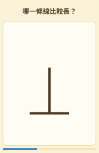 | **錯覺大師** | 兩個圖形比一比，哪個比較長、比較大、比較亮？眼睛會騙人！共有十一種經典的視覺錯覺（線條、圓、帽子、長方形、灰色…），有時候錯覺會幫你，有時候剛好相反，而且真正的差距會越來越小。答完立刻揭曉真相，連對越多越好。 |
| 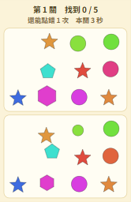 | **哪裡怪怪的** | 畫面分成上下兩格，各有 10 個一樣的圖形，其中 5 個的大小、顏色或位置不一樣。上格、下格的圖形都可以點，找齊 5 個就進下一關，而且差異會越來越小。不限時間，慢慢找！ |
| 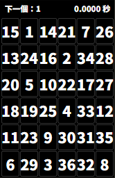 | **數字方陣** | 黑色方格裡有 1 到 36 的數字，請照順序從 1 一直點到 36，點完停表，越快越好！點對的格子會閃一下綠底白字；只要點錯一個，就會停在那裡讓你看看錯在哪。 |
| 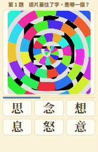 | **半邊字** | 畫面上的字只露出一半，從下面的字裡選出最可能的那一個。露出的部分會越來越少，選項會增加到六個，字還會越來越歪，每題時間也越來越短！ |
| 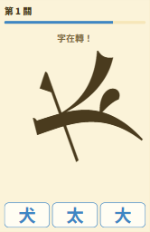 | **鏡中旋轉字** | 畫面中央有一個大字，它會左右鏡射、一直旋轉，剛出現時轉得非常快，之後越轉越慢，但字也會越縮越小。下方有幾個長得很像的字，點出「這個字原本是哪一個」。答錯或來不及就結束，看你能過幾關。越後面的字筆劃越多！ |
| 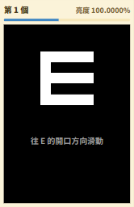 | **淡到看不見** | 黑色背景上有一個白色的 E，開口朝上、下、左、右其中一邊，手指往開口的方向滑。E 一個比一個暗，最後幾乎和背景一樣黑。答錯或來不及就結束，看你能看清楚幾個。請把螢幕亮度調到中等。遊戲視力，不是真正的視力檢查。 |
| 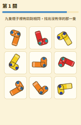 | **落單的襪子** | 九隻襪子排成九宮格，其中有四對圖案一模一樣，只有一隻沒有伴。找出那隻落單的襪子，點下去。襪子的底色只有彩虹七色，每一隻都轉成不同的角度。每關有時間限制，答錯或來不及就結束。越後面，底色種類越少，要靠條紋和圓點來分辨！ |
| 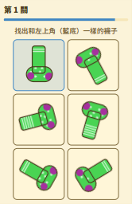 | **雙胞胎襪子** | 左上角有一隻不會動的目標襪子（藍色底）。其他襪子都在慢慢轉動，其中只有一隻跟目標「完全一樣」（底色、腿上的條紋數、腳上的圓點數都相同），其他的至少有一處不同。找出它並點下去！ |
| 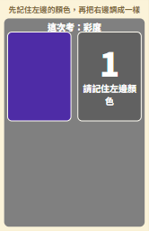 | **記色調色** | 先看左邊的色塊 3 秒，記住它的顏色。3 秒後色塊消失，右邊會出現另一塊顏色，拖曳下方橫條，把它調回剛剛看到的顏色。每次只考色相、彩度、明度其中一項。只有一次機會，按「確定」後會告訴你色差。 |
| 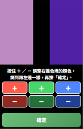 | **混出什麼色** | 左邊是目標顏色，右邊是你要調出來的顏色。下方三對按鈕分別控制右邊色塊的紅、綠、藍：亮色的「＋」按住會增加、暗色的「－」按住會減少，按越久變得越快。 |
| 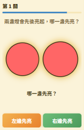 | **誰先亮** | 左右兩盞燈會先後亮起，兩盞都亮了之後，點「先亮的那一盞」。兩盞燈的時間差一關比一關短，最後只差幾個畫面影格。答錯或來不及就結束，看你能過幾關。請讓畫面保持在前景。 |
| 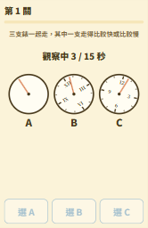 | **哪支錶不準** | 三支錶一起走，秒針每秒跳一格。其中一支走得比較快或比較慢，選出不準的那一支。三支錶的秒針位置和錶面朝向都不一樣，要看的是跳動的節奏有沒有慢慢滑開。一開始就可以作答，點了答案按鈕就不能再按。答錯或來不及就結束。 |
| 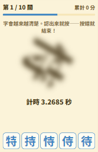 | **越看越清楚** | 畫面上有一個字，一開始又模糊又轉得很快，會慢慢變清楚、轉慢。下方有五個長得很像的字，認出來就按：越早按對分數越高。但是按錯或來不及就結束！共十關，成績是累計分數，所以不要亂猜，有把握再按。 |
| 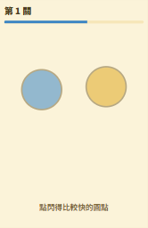 | **誰閃得快** | 左右各有一個圓點在閃爍，點「閃得比較快」的那一個。兩個圓點的顏色、位置、閃爍的起點都不一樣。點錯或來不及就結束，看你能過幾關。越後面，兩邊的快慢越接近，每一關都比上一關更難分辨！ |
| 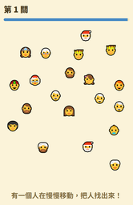 | **誰在偷偷動** | 畫面上有一堆人臉，其中有幾個會輪流慢慢移動，其他都不動。一個動一下就換下一個，在限時內，一個接著一個把「所有」會動的人都點出來（點對的會加上綠框、停下來）。越後面，人越多、會動的越多、漂移得越慢！ |
| 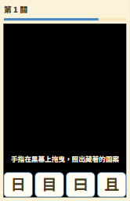 | **手電筒猜圖** | 畫面全黑，手指拖到哪裡，手指上方就會亮起一圈光，黑幕底下藏著一個圖案。用光圈到處掃，猜出藏的是什麼，點下面四個選項之一。四個選項長得非常像（相似的數字、形近的繁體字、只差零件數的圖形），只看一個角落分不出來。 |
| 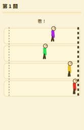 | **誰先衝線** | 先倒數 3、2、1， |
| 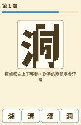 | **對準才看到** | 一個中文字被切成許多直條，每一條都在上下循環移動，速度各不相同。只有在所有直條剛好對準的那一瞬間，整個字才會完整浮現。看出它是哪個字，點下面的選項。選錯或來不及就結束，看你能過幾關。越後面，直條越細、對準得越快！ |
| 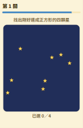 | **找正方形** | 夜空裡撒著一堆星星，剛好有四顆星能連成一個正方形。把這四顆星點出來，點滿四顆就判定。正方形大多是斜的，旁邊還有差一點點的菱形、長方形（四邊一樣長但角不是直角，或角是直角但邊不一樣長）。點錯就結束，看你能過幾關。 |
| 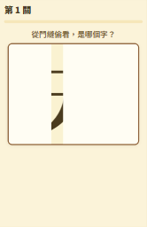 | **門縫偷看** | 一個滿版的黑色大字，上面蓋著兩片白色方塊，中間只留一條窄窄的縫。兩片方塊一起由左往右移動，縫就從字的左邊掃到右邊——你只能透過門縫，一條一條看到經過的筆畫。 |
| 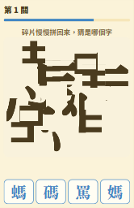 | **找星座** | 題目是一個筆劃很多的字，大大的佔滿畫面。這個字被切成很多小方塊，散落在畫面各處，然後一塊一塊慢慢飛回原來的位置——每一塊的速度不同、開始的時間也不同。你要猜這是哪個字。 |
| 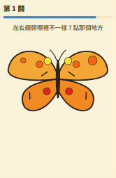 | **蝴蝶不對稱** | 一隻蝴蝶，左右兩邊翅膀應該是鏡射對稱的，但有一個地方不對稱——可能是一個斑點的大小、一個斑點的顏色、或一條紋路的方向。點那個地方（點它或它在另一邊的對應位置都算）。要在腦中把一邊翅膀左右翻過來比，比並排找碴難很多。 |
| 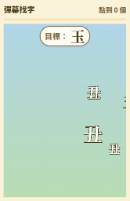 | **彈幕找字** | 很多字從右往左飄過畫面（像影片的彈幕），速度不一樣、有大有小，有的還會重疊。上方寫著目標字，看到目標字就點它。點錯（點到長得像的形近字）就結束，讓目標字飄出畫面也結束。成績是一共點到幾個，越多越好。 |
| 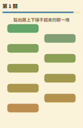 | **色票排隊** | 畫面由上到下疊著 9 塊色塊，顏色是漸層，但有一塊的顏色被偷偷改過（色相、彩度或明度）。把被改過的那一塊點出來！色塊一左一右錯開擺放，上下不貼在一起，只能靠眼力比。 |
|  | **動態視力** | 一列火車從右往左開過去，其中一節車廂的窗戶貼著黃底黑字的號碼。火車開走之後，從下面 4 個選項點出那個號碼。別的窗戶裡有乘客、便當、報紙，後面還會貼英文字母的假貼紙來干擾你。 |
|  | **洗盤子** | 盤子一個一個送過來，上面有咖啡色的醬汁污漬。手指在污漬上來回刷（畫圈），污漬就慢慢淡掉；整個盤子的污漬都洗掉，會自動換下一個盤子。 |
|  | **挑豆子** | 阿嬤的紅豆裡混著別的東西。用手指把不是紅豆的雜物（小石頭、綠豆、黑豆……）往盤子外面拖出去，不用拖到哪裡，拖出盤緣就行。拖到紅豆會扣時間。 |
|  | **圈內圈外** | 地上有一條彎來彎去、首尾相連的紅色繩圈（不會自己交叉），上面有一隻螞蟻。螞蟻在繩圈的裡面還是外面？ 點「裡面」或「外面」。 |
|  | **emoji選** | 方格裡排滿各種 emoji：圓臉、動物、蔬果、交通工具、人形。畫面上方寫著這一關要點的種類（名稱後面有代表圖案），例如「圓臉、動物」，在時間內把屬於這幾類的全部點掉。點錯一個就失敗，時間到了還沒點完也失敗。 |

### ⚡ 反應類遊戲（29 款）

抓準時機。有的要在心裡默數、有的要算準落下的瞬間，常常只有一次機會，成績是「差了幾秒、幾度」。

| 縮圖 | 遊戲 | 玩法與特點 |
|:---:|:---:|---|
|  | **零秒出手** | 請在心裡默數至零，快速點擊按鈕，看看你差了幾秒。從 7.0000 開始倒數，畫面會顯示 X.XXXX 秒；倒數到 4.0000 秒時，數字會慢慢變透明，到 3.0000 秒就完全看不見，剩下的 3 秒要靠自己在心裡默數。 |
|  | **不可能任務** | 畫面上方是阿湯哥，下方是一條紅色警戒線。點一下畫面，他就會像自由落體一樣開始往下墜落；算準時機再點一下畫面，就能讓他停在半空中。 |
|  | **七彩陷阱** | 畫面上有 2×2 四個方塊，會照順時針的順序，一個接一個換上七彩顏色（最新的那個有白邊），而且換得越來越快。一開始只要點「紅色」方塊：紅色一出現，就要在下一個方塊出現之前馬上點下去！來不及，或是點到別的方塊，都算失敗。 |
|  | **六點鐘方向** | 鐘擺從五點鐘的位置出發，順時針往下擺，點一下讓它停住，越接近正下方（六點鐘方向）越好。每局只有一次機會；停住後鏡頭會放大，告訴你差了幾度，目標是 0.0000 度！ |
|  | **神準落下** | 畫面上方是藍色倒三角形，會左右來回移動、撞到邊緣就反彈；下方是一把尺，中間的紅色目標區是這一關要插進去的地方。請預測落下的時機，點擊「落下」——三角形會像自由落體一樣越落越快，釘在尺上就不再移動。插進紅色目標區就過關，畫面會往釘住的那一點放大，讓你看清楚插得有多準（紅色裡還有黃色、紫色的核心）。 |
|  | **猜拳必贏** | 上面倒數 3、2、1、0。數字變成 0 的時候電腦出拳，你只有 1.0000 秒可以按下「剪刀／石頭／布」，太早（還沒到 0）或太慢都算輸。前面的關卡可以先看電腦出什麼再出，越後面電腦出得越晚，留給你看的時間越短！ |
|  | **心跳複製** | 左、中、右三個位置會冒出球（有時一顆、有時兩顆、有時三顆，有時這一拍什麼都沒有），球外面有一圈倒數圈，要在圈跑完之前點到球。節奏一開始很規律，然後會突然改變！拍子越來越快，兩顆以上要全部點完。 |
|  | **落下棍子** | 上面掛著六根棍子，會在不同時間掉下來。要在棍子掉出畫面之前點到它！點到還沒掉的棍子也算錯失。每一關只能錯失一根，棍子會越來越短喔！ |
|  | **老師說** | 老師會下指令。只有開頭有「老師說」的才要照做，例如「老師說 點左邊」就點左邊；沒說「老師說」就什麼都不要點。後面還會有「點左邊的相反」這種指令，要點反方向；高關卡還有「點左邊跟上面」，要同時點兩個方向（半秒內都點到）。 |
|  | **左右不同拍** | 左右各有一條軌道，有顏色的方塊會由上往下掉，碰到下方紅線的那一刻，就點該邊（左手點左邊、右手點右邊）。顏色代表到下一個方塊隔幾拍：紅 4 拍、橙 2 拍、黃 1 拍、綠半拍、藍四分之一拍、紫八分之一拍。 |
|  | **兩針重疊** | 圓盤上有兩根指針，長針轉得快、短針轉得慢，圓盤沒有任何刻度。在兩根針剛好疊在一起的瞬間按下「重疊！」。每次只能按一次，不用等第一次重疊，任何一次都可以。成績是按下時兩針的夾角，目標是 0.0000 度。 |
|  | **搭一座橋** | 上方有一塊橫板，下方有兩塊方塊各自左右來回移動，兩塊的速度不一樣，一開始的位置和方向也是隨機的。 |
|  | **穿過旋轉縫** | 圓環一直在旋轉，環上有一個缺口。點一下螢幕，環裡的砲台會射出砲彈，飛 0.6 秒後抵達環的上緣，那一刻缺口要剛好轉到上方，砲彈才能穿出去。撞到環就結束，看你能射出幾顆。 |
|  | **切菜單上的** | 關卡一開始，黑板菜單會亮出今天要用的幾種水果（3 秒），然後收起來。接著水果一顆一顆拋上來，用手指切過去，只切菜單上有的，其他的不要切。切錯一顆、或漏掉一顆菜單上的，就結束。 |
|  | **切字** | 上方寫著目標字。一個一個寫著字的湯圓像水果一樣拋上來，用手指切過去，只切目標字，其他的字不要切。切錯一顆、或漏掉一顆目標字，就結束。小心：拋上來的其他字全是目標字的形近字（像「己」配「已、巳、巴」），字在空中還會旋轉。 |
|  | **照號切水果** | 水果像煙火一樣噴上來（常常好幾顆同時），每顆上面寫一個數字。照號碼 1、2、3… 的順序，用手指在畫面上劃過去切它。切錯順序就結束，水果掉到畫面下面還沒切到也結束。 |
|  | **心臟病** | 小時候玩的撲克牌遊戲。牌一張一張翻出來，你要在心裡一直數「A、2、3…K、A、2…」——畫面只在前 3 張告訴你數到哪，之後要自己數。翻出來的牌剛好等於你心裡數到的數字，就拍下去（點畫面任何地方）。 |
|  | **舉旗子** | 你兩手各拿一面旗子：左手紅旗、右手白旗。口令一句一句出現：「紅旗舉起來」「白旗不要放下」。畫面左半邊（左手拇指）管紅旗、右半邊（右手拇指）管白旗，按住＝舉起來，放開＝放下，左右可以同時用。 |
|  | **零錢入筒** | 硬幣從上面掉下來，要在它掉到筒子口之前用手指滑進對的筒：銅色的大硬幣（50 元）往左滑、銅色的小硬幣（5 元）往下滑、銀色的大硬幣（10 元）往右滑，筒子上有箭頭提醒。有時候一次掉好幾枚，每次滑都是滑最下面那一枚，要先看清楚誰比較低！ |
|  | **大合照** | 一群人排排站拍大合照，大家會各自隨機眨眼。等到所有人都睜著眼睛的那一瞬間，按下快門！照片洗出來，只要有人閉眼就失敗（閉眼的人會被紅圈圈起來）。注意：低頭看手機的人眼睛看起來像閉著，但不算閉眼；他們偶爾會放下手機抬頭，這時就跟大家一樣會眨眼。 |
|  | **釣魚提竿** | 浮標浮在水面上。魚會來輕輕碰（浮標小小地晃一下，不要提），真的咬鉤時浮標會整個沉下去——那一刻在畫面上往上滑提竿！太早提魚就跑了，沉下去太久才提魚也跑了。每關釣一條魚。 |
|  | **吸珍珠** | 一杯珍珠奶茶，上面寫著要吸 N 顆珍珠。按住吸管開始吸，珍珠一顆一顆（有時一串好幾顆擠在一起）沿著吸管往上衝，放手就停。 |
|  | **釣魚玩具** | 池塘在轉，塑膠魚的嘴巴一張一合。看準時機點一下放釣竿——釣竿要 0.4 秒才會落到水面，所以要預判：落水的那一刻，要剛好有指定顏色的魚、嘴巴張開著，經過釣竿正下方（畫面上方的指示線），才釣得起來。 |
|  | **一心二用** | 右邊的圓燈亮綠色就馬上點它；左邊的燈會閃紅色，不能點，只要在心裡默默數它閃了幾次。這是闖關：第 1 關很短、燈也亮得慢，讓你熟悉玩法；後面每一關時間更長、燈亮更多次、間隔更短。 |
|  | **反著滑** | 畫面分成九宮格，每一關只會出現一個箭頭（上、下、左、右）。箭頭一出現就要用手指往「反方向」滑——箭頭朝上就往下滑，朝左就往右滑（在畫面任何地方滑都可以，不用等箭頭消失）。 |
|  | **全壘打** | 投手投球，球進到好球帶（畫面中央的方框）的那一瞬間，點一下畫面揮棒。壞球（偏出好球帶）不要揮，好球沒揮也算失敗。小心：變速球出手的動作一模一樣，但是飛得比較慢，要多等一下；曲球一開始像好球，最後才彎出好球帶。 |
|  | **砲打飛機** | 畫面最下方有一座固定不動的砲塔，點畫面任何地方就往正上方開一砲，砲彈等速往上飛，一共只有 30 發。天空由上到下有 10 種飛行器飛來飛去：飛碟、衛星、火箭、隱形戰機、戰鬥機、空中巴士、私人飛機、螺旋槳飛機、雙層翼飛機、直升機，越上面越小，速度各不相同。 |
|  | **草叢找動物** | 草原上長滿一叢一叢開著花的矮灌木，小動物會不定時在灌木後面冒出來，跑一小段又躲回去，只能從灌木的空隙看到牠的一部分。看到小動物就點牠，點到一隻得 1 分。限時 60 秒，成績是一共找到幾隻。 |
|  | **泡泡掃射** | 按住畫面，砲塔就朝手指的方向一直連射，手指移到哪裡就掃到哪裡。紅色大泡泡被打中會破成兩顆橘色泡泡，橘色再破成黃色，接著是綠、藍、靛、紫，越破越小、越多、飄得越快。每顆子彈打中一顆泡泡就會消失，泡泡之間會重疊不會互撞。 |

### 🔢 數字類遊戲（39 款）

心算、湊數、估算，與生活貼近的錢、折扣、日期、時間。畫面不會幫你加總，要自己算。

| 縮圖 | 遊戲 | 玩法與特點 |
|:---:|:---:|---|
|  | **零錢分類** | 上面是題目，例如「8 枚湊出 134」，桌上散著 50、20、10、5、1 元各種硬幣。點選硬幣，剛好選 8 枚、而且總和剛好是 134 元才算過關，答案只有一種。小心：50 元拿太多會超過，枚數也不能多、不能少，有的硬幣一枚都不該拿！ |
|  | **對發票** | 上面是一張 8 碼發票，下面是這一期的開獎號碼。發票的「末幾碼」跟第一獎相同，就中對應的獎（末 3 碼六獎，末 8 碼一獎）；特別獎要整張 8 碼完全相同；都沒中就按「沒中獎」（在最上面）。 |
|  | **價格陷阱** | 上下兩張價格標籤，原價用中文數字寫，再加上各種優惠（打折、現折、每滿減、滿額折、折價券）。算一算實際要付多少錢，點出比較便宜的那一張。兩邊都有的「會員再打幾折」不用算！越後面兩張價錢差越少，時間也越短。 |
|  | **撕日曆** | 這是一天一張的日曆，點一下撕掉一張、換成隔天，不能回頭。要在時間內撕到上面指定的日子（日期、星期、節日、節氣…），到了按「就是這天」。撕過頭就失敗！ |
|  | **逢七過** | 上面的數字會一個一個往上加。普通的數字要點上面的數字格子；遇到 7、7 的倍數（14、21、28…），或是數字裡有 7（17、27、70～79…），要按下面的「跳過」。每個數字都有倒數，越後面越短。 |
|  | **算式對不對** | 畫面上有一個算式，判斷這個算式是「對」還是「錯」，錯的算式都只差一點點（差 10、十位個位對調、正負號顛倒…）。第 15 題起會出現負數，小心「減去負數」和兩個負數！ |
|  | **分數大對決** | 兩個分數卡，點比較大的那一張。作答時不會顯示小數，要靠數感判斷。小心：分子一樣、分子分母各差 1、分母是倍數但分子故意差一點這些陷阱題。後面還會有三位數、帶小數點的分數。答錯或來不及就結束，看你能連續答對幾題。 |
|  | **質數陷阱** | 畫面中央有一個數字，判斷它是「質數」還是「合數」。小心：91、77、119 這些數字長得像質數，其實是合數！答錯或來不及就結束，看你能連續答對幾題。越後面，數字越大、時間越短。 |
|  | **兩張成百** | 30 張數字牌，每次點兩張，加起來剛好是 100 就會消除，全部消完為止。畫面不會幫你加總，要自己算！小心「差一點」的組合（例如 47 和 63 是 110）。點錯一組加 3 秒，超過 180 秒就失敗，用時越短越好。 |
|  | **三張成百** | 數字牌橫向每排 3 張，每次選三張，加起來剛好是 100 就會消除，全部消完就過關。第 1 關只有 6 張牌，之後每三關多 3 張牌，限時從 180 秒起、每關多 20 秒。畫面不會幫你加總，要自己算！ |
|  | **乘法表抓錯** | 9×9 乘法表裡有 9 格的答案被偷偷改過，找出它們。背過九九乘法表的人很有利，也可以利用對稱（3×7 和 7×3 一樣）來檢查。點錯一格加 3 秒，找齊 9 格就結束，用時越短越好。 |
|  | **拼出最大數** | 上方有一個算式，三個空格之間有兩個運算符號（乘除先算）。從下方 6 張數字牌依序選 3 張填進空格，讓算式的值最大，按「確定」。後面的牌會有負數：負負相乘（除）得正，減負數等於加。填錯了按「重來」。 |
|  | **菜籃總價** | 上方是這次要買的總價。從下方六樣蔬菜水果挑幾樣，讓標價加起來剛好等於總價，按「結帳」。畫面不會幫你加總，要自己算。有兩條命，結帳錯一次扣一條。每關有時間限制，越後面要選的樣數越多、差一點點的組合越多。 |
|  | **數線落點** | 畫面上有一條數線，只標了 0 和 1。上方出現一個 0 到 1 之間的數（可能是小數、分數或百分比），在數線下方的拖曳區左右拖曳，把圓點移到你覺得它該在的位置，按「確定」。 |
|  | **等不等於** | 畫面上有一道等式，左右兩邊的寫法不一樣（分數、小數、百分比）。判斷兩邊是「相等」還是「不相等」；不相等的題目都只差一點點。答錯或來不及就結束，看你能連續答對幾題。越後面，限時越短！ |
|  | **先乘除** | 畫面上有一道四則運算，下面的答案只有一個是對的。要記得：括號先算，再算乘除，最後才算加減。有一個錯的答案，是「由左到右一路算下去」的陷阱。答錯或來不及就結束，看你能連續答對幾題。 |
|  | **求餘數** | 畫面上有一個除法，例如 4521 ÷ 7，請點出「餘數」是多少。下面有五顆數字按鈕，錯的選項都只差一點點。答錯或來不及就結束，看你能連續答對幾題。越後面，被除數越大、除數越難、限時越短！ |
|  | **遮住的數字** | 上面是一道計算式，中間顯示答案，但故意遮住其中一個數字。算一算，點出下面 0～9 裡被遮住的是哪一個數字。答錯或來不及就結束，看你能連續答對幾題。越後面，算式越難、限時越短！ |
|  | **幾點幾分後** | 生活裡的時間算術，例如「現在是 10:45，過了 135 分鐘是幾點？」下面有兩個時間，點出正確的那一個；錯的那個是常見的算錯方式。後面還會「倒推」出門時間。答錯或來不及就結束，看你能連續答對幾題。 |
|  | **哪一行算錯** | 一份計算過程有好幾行，其中「有一行算錯」，點出算錯的那一行。算錯的結果，後面幾行會接著用下去，所以要一行一行檢查。點錯或來不及就結束，看你能連續答對幾題。越後面，行數越多、錯得越細！ |
|  | **挑加減乘除** | 算式裡有加減乘除符號不見了，換成直排的四顆按鈕（＋ − × ÷）。請選出正確的符號，讓等號成立。只有一種填法是對的。空格有好幾個時，每個空格各選一個，確認算出來的數字再按「確定」。選錯或來不及就結束，看你能過幾關。 |
|  | **支票金額** | 支票上有小寫金額（阿拉伯數字）和大寫金額（壹貳參肆…），判斷兩者「相符」還是「不符」。不符的地方都很小：少寫一個零、仟佰互換、數字對調。答錯或來不及就結束，看你能連續答對幾題。越後面，金額越大、零越多！ |
|  | **換一張就平** | 上下兩排數字牌，頭上的泡泡寫著各自的總和。上排點一張、下排點一張，兩張交換，要讓交換後兩排的總和一樣。答案通常只有一組。 |
|  | **推星期幾** | 上面是撕日曆，寫著某一天是星期幾。下面問另一天是星期幾，點七顆星期按鈕。先算兩天相差幾天，再除以 7 看餘數，星期就往後（或往前）推那麼多天。 |
|  | **加到五百** | 加油站的油槍。上面寫著油價和要加多少元。按住油槍開始加油，畫面上只顯示「已加幾公升」（一直在跳），金額被蓋住了。要自己心算：金額 ÷ 油價 ＝ 要加幾公升。 |
|  | **數鈔票** | 一疊鈔票，面額 100、500、1000 元混在一起，順序打亂。上面寫著目標金額（例如「數出 3700 元」）。每點一下，最上面那張鈔票就撥到右邊，要邊撥邊心算。你覺得撥出去的剛好是目標金額，就按「好了」。 |
|  | **一路減七** | 一開始提示「請從 1000 開始計數」。然後出現大大的「−7」，下面有九個數字按鈕，三個一組、每組的個位數都一樣——選出目前的數字減 7 的答案。答對了，就再 −7。目前的數字不會顯示，要自己記住答案一路算下去。 |
|  | **迴轉壽司** | 迴轉壽司的輸送帶，盤子的顏色代表價格（白 30、紅 40、藍 60、金 100，價目表貼在上面）。上面寫著預算（例如「剛好 280 元」）。盤子經過時點它就拿下來，拿下來的疊在旁邊，只看得到最上面一個，總金額不顯示。 |
|  | **找錢** | 收銀台前，客人買了 386 元，給你 1000 元，用數字鍵輸入要找多少錢（614）。輸入的位數夠了就自動判定，也可以按 ⌫ 刪掉、按 ✓ 提早送出。借位最容易錯（1000 − 386 常常算成 714 或 624）。 |
|  | **打了幾折** | 百貨公司吊牌：「原價 800 元，特價 560 元」，這是打幾折？ 點下面的折數按鈕。台灣的「7 折」是付原價的 70%（不是減 30%），所以7 折和 3 折（付 30%）很容易搞混——小心！ |
|  | **刪數湊和** | 方陣裡每一格有一個數字，每一排、每一列旁邊各有一個「目標」。點掉一些數字（刪除），讓每一排、每一列剩下沒刪的數字加起來，剛好等於旁邊的目標；再點一下可以恢復。 |
|  | **魔方陣** | 把數字 1、2、3… 各填一次，讓每一橫排、每一直行、兩條對角線，加起來的總和都一樣（3×3 是 15，4×4 是 34）。盤面已經給了幾個數字。 |
|  | **搶十五** | 桌上有 1～9 九張牌，你和電腦一開始各已經拿了一張，接著兩個人輪流各拿一張，你先拿。誰先讓自己手上的三張牌加起來剛好 15，誰就贏，例如你手上有 2 和 4，再拿 9：2＋4＋9＝15，你贏了！點一張牌，再按「拿這張」。 |
|  | **田忌賽馬** | 對方的馬已經排好出場順序，每匹馬有一個戰力數字（一開始就看得到）。你也有同樣多匹馬，排出你的出場順序；每一場戰力高的贏。你要贏到「這一關最多能贏的場數」。 |
|  | **時刻表補字** | 站牌上的公車時刻表被雨淋糊了：每一欄是一班車、每一列是一站，格子裡是到站時間。規則只有一條：每一班車從這一站開到下一站，花的時間都一樣。點灰色的格子，用數字鍵填「幾點幾分」（打 758 就是 7:58）。 |
|  | **撲滿有多少** | 小豬撲滿打不開，裡面有幾種遊戲硬幣，每種硬幣的重量都是質數（寫在硬幣上）。你只知道撲滿裡硬幣的總重（前面幾關還會告訴你一共幾枚），以及一條規矩：每種都是 1～9 枚，或每種都是偶數枚。 |
|  | **保存期限** | 最上面用大字寫著今天的日期（有些關卡還有現在幾點）。中間是一樣食物，標著製造日期和保存幾天（有些是保存幾小時）。製造日期加上保存天數就是到期日，到期日當天還可以吃，隔天起才算過期。 |
|  | **水果進出貨** | 水果攤上面寫著每種水果的顏色、1 公斤有幾顆、早上有幾顆；下面是今天一筆一筆的進貨和賣出，水果名稱前面有水果的圖案，有的只寫顏色（「紅色的」），有的寫顆數，有的寫公斤。只要算出被問到的那幾種（黃底的那幾列）收攤時各剩幾顆，前面的關卡只問 1 種，越後面問越多：點「收攤剩」的格子用數字鍵填，全部填好按「對帳」。 |
|  | **抱著量體重** | 畫面最上面寫著這一關出場的人和東西。他們兩個或三個一起站上體重計（抱著、提著），紀錄寫成一條一條，例如「阿公＋寶寶＝82 公斤」；前面幾關有的紀錄是「一個人單獨量」，最前面幾關還有「全部一起」量的重量。題目問其中一個幾公斤，用數字鍵填答案、按「確定」。 |

### 🧩 邏輯類遊戲（29 款）

數獨、魔方陣、取火柴、田忌賽馬…大多**不限時**，慢慢想；填錯不會結束，靠推理一步步解開。（疊箱子、形色不相鄰、六角著色雖然也是邏輯題，但每一關有時間條，超過時間就失敗。）

| 縮圖 | 遊戲 | 玩法與特點 |
|:---:|:---:|---|
|  | **冰箱歸位** | 買菜回來，東西一樣一樣出現在上面的大格子裡。下面有三顆按鈕：左上「冷藏室」、左下「冷凍庫」、右邊「櫥櫃（不用冰）」，點一下把東西放進去。有些東西很容易放錯，要在時間內放對喔，放錯一次就結束！ |
|  | **接水管** | 點一格水管，它就轉一下。把上方水龍頭流出來的水（水龍頭的位置每一關都不一樣），接到每一個水桶，而且管子不能漏水（紅點就是漏水的地方）。後面的棋盤更大、水桶更多、路線更複雜。每一關都有時間限制，看你能接幾關！ |
|  | **關燈** | 點一盞燈，它和上下左右的燈都會「亮變暗、暗變亮」。想辦法在時間內把所有的燈都關掉！剛好用最少的步數過關，會得到「完美」。時間到就失敗，一次失敗就結束。 |
|  | **猜下一個** | 上面一排圖案有規律：形狀、顏色、方向或大小，會照著某種順序改變；有時候是一排數字，要找出數字之間的關係。看出規律，從下面四個選項裡，點出「下一個」是什麼。每題有時間限制，答錯就結束，規律會越來越難發現！ |
|  | **能一筆畫嗎** | 畫面上是一個由點和線組成的圖形。判斷能不能「不重複走同一條線、筆不離開」，把全部的線一次畫完。答錯或來不及就結束，看你能連續答對幾題。提示：數數看，每個點連著幾條線。 |
|  | **數獨猜一格** | 標準的數獨：每一橫排、每一直排、每一個宮裡，數字都不重複。前面的關卡是 4×4（四個 2×2 的宮，數字 1～4），第 6 關起是 6×6（六個 3×2 的宮，數字 1～6），第 11 關起變成更難的 9×9（九個 3×3 的宮，數字 1～9）。 |
|  | **左右合字** | 左右兩欄各有一些偏旁。先點左邊一塊、再點右邊一塊，把它們連起來：只要能合成一個字就連出綠線（不一定要跟我想的一樣），不能合成就連出紅線（扣一條命，共 3 條命）。 |
|  | **鋪地毯** | 房間裡要鋪地毯。手指從黃色的地毯捲開始，往上下左右的相鄰格拖，一路把地毯鋪出去。每一格地板都要剛好鋪到一次，放著家具的格子不能走。往回拖就是把地毯捲回來，走進死路不會結束，自己捲回去換條路。 |
|  | **接電線** | 方格板上有幾對同顏色的插頭。手指從一個插頭拖到同色的另一個插頭，拖過的格子會變成電線。電線必須占滿每一格且不能交叉才過關。拖錯了，從插頭重新拖就好。來不及就結束，看你能過幾關。 |
|  | **單行道** | 街道上畫滿了單行道的箭頭。手指從左下角的計程車開始，沿著街道拖出路線，只能順著箭頭的方向走，逆向的路段拖不過去。把計程車帶到右上角的醫院就過關。拖回上一個路口，路線就退回一格。 |
|  | **缺哪一張** | 麻將桌上有一排同花色的數字牌（一～九）。補哪些牌，就能把整排湊成「三張連號」或「三張一樣」的組，再加一對相同的牌？例如 2 3 4 是連號、5 5 5 是三張一樣。 |
|  | **翻最多棋** | 這是黑白棋（奧賽羅）的殘局，你是黑棋。點一個空格下黑棋，夾住的白棋全部會翻過來。要下在「這一步能翻最多顆」的那一格（並列最多也算對）。下完會把每個位置能翻幾顆都標出來，你下的不是最多就結束，看你能過幾關。 |
|  | **堵住五子** | 這是五子棋的盤面，白棋快要贏了。你只能下一顆黑棋，點那個唯一能化解的位置。 |
|  | **蹺蹺板比重** | 蹺蹺板上一開始就坐著幾隻動物，板子是歪的。動物越大越重（身上的數字是重量），座位離支點越遠，壓得越用力：每隻動物的力道＝重量×離支點的格數。把動物拖到合適的座位，讓兩邊的力道加起來一樣，蹺蹺板就平衡了。 |
|  | **跳棋跳最遠** | 這是方格版的跳棋。紅色彈珠可以跳過相鄰的任何一顆棋子（往上下左右），落到後面的空格，而且可以一直連跳（同一個格子不能降落兩次）。點出哪一顆紅棋能連跳最多次，點下去它就連跳一遍。 |
|  | **時間連連看** | 畫面上混著指針鐘和電子鐘（電子鐘是 24 小時制，例如 15:15）。先點一個、再點一個，把顯示同一個時間的指針鐘和電子鐘配成一對。 |
|  | **刮刮樂推理** | 上方是這一關的 6 種圖案。下方 12 張牌藏著 3 張一模一樣的圖案，每張牌只露出幾個宮格當線索。比對露出的宮格，推理哪幾張是同一個圖案，點牌就把它整張刮開。最多只能刮開 6 張，找到 3 張相同的就過關。 |
|  | **數獨4** | 在 4×4 的格子裡填入 1～4，每一橫排、每一直排、每個 2×2 的小宮，數字都不能重複。點一格，再點下面的數字；數字重複會變紅。沒有時間限制，也不會因為填錯而結束，慢慢想；全部填對就換下一題。 |
|  | **數獨6入門** | 在 6×6 的格子裡填入 1～6，每一橫排、每一直排、每個「2 排 3 欄」的宮，數字都不能重複。點一格，再點下面的數字；數字重複會變紅。沒有時間限制，也不會因為填錯而結束；全部填對就換下一題。 |
|  | **數獨6中階** | 在 6×6 的格子裡填入 1～6，每一橫排、每一直排、每個「2 排 3 欄」的宮，數字都不能重複。這一款題目給得很少（約 10 個），要靠筆記（在格子角落記下可能的數字）一步一步縮小。 |
|  | **數獨9入門** | 在 9×9 的格子裡填入 1～9，每一橫排、每一直排、每個 3×3 的宮，數字都不能重複。點一格，再點下面的數字；數字重複會變紅。沒有時間限制，也不會因為填錯而結束；全部填對就換下一題。 |
|  | **數獨9中階** | 在 9×9 的格子裡填入 1～9，每一橫排、每一直排、每個 3×3 的宮，數字都不能重複。這一款提示約 23～30 個，而且一定要用到「數對」或「鎖定」這類進階技巧，建議用筆記記下每格可能的數字。 |
|  | **數獨9高階** | 在 9×9 的格子裡填入 1～9，每一橫排、每一直排、每個 3×3 的宮，數字都不能重複。這一款提示只有 22～26 個，要用到「隱性數對」「三數組」「X 翼」這類高階技巧，一定要善用筆記。 |
|  | **夾心數獨** | 標準數獨：每一橫排、每一直排、每個宮裡，1～N 各出現一次。 |
|  | **黑白不連三** | 每一格塗黑或白，要符合兩條規則：①同色不能連續三格（橫的、直的都一樣）；②每一排、每一列，黑和白一樣多。題目已經給的格子不能改。下面先選「黑」「白」或「清除」，再點格子。 |
|  | **取火柴** | 桌上有幾堆火柴（一排一堆）。你和電腦輪流，每回合只能從「同一堆」拿走任意根（至少 1 根）；拿走最後一根的人贏（後面幾關相反：拿走最後一根的人輸）。你先手，點一根火柴會選取它和它右邊所有的火柴，再按「拿走」。 |
|  | **疊箱子** | 倉庫的架子每格放一箱，規矩是越下面越重、越右邊越重：每一箱都要比它上面那箱重、也比它左邊那箱重（後面的關卡一樣重也可以）。深色的箱子已經貼好重量、固定在那裡（左上角一定最輕、右下角一定最重，已經先放好了），其他的重量在下面的清單上。 |
|  | **形色不相鄰** | 九宮格（之後是 16 格、25 格）。下面有一盒圖形，每種形狀配每種顏色剛好一個。把全部的圖形擺進格子：形狀一樣或顏色一樣的兩個，不可以左右相鄰，也不可以上下相鄰，後面的關卡連斜角也不能相鄰，隨手亂擺會卡死，要推理。 |
|  | **六角著色** | 六角形的格子塗顏色：相鄰的兩格不可以同色，每種顏色剛好用完下面寫的格數。先點顏色再點格子；選「收回」再點格子就拿掉顏色。長按格子可以做記號（?、X、可能的顏色組合），只是參考。 |

### ✋ 手感類遊戲（19 款）

拖曳、按住、放開、滑動，考手指的控制力與節奏，有的有慣性、有的畫面會抖。

| 縮圖 | 遊戲 | 玩法與特點 |
|:---:|:---:|---|
|  | **抽光衛生紙** | 把整捲衛生紙抽光！手指在螢幕上一直往下滑，紙就一路被拉出來；放手時如果還在往下滑，紙會帶著慣性繼續滑一小段。要抽滿 50 個螢幕高度，看你多快。從第一次往下滑才開始計時。 |
|  | **吹氣球** | 按住畫面開始充氣，放手就結算氣球的「容量」。畫面上不會顯示任何數字，氣球還會一直晃動干擾你，而且每一局灌氣的快慢都不一樣，只能憑感覺決定什麼時候放手。吹太久氣球會爆，爆了就是 0 分。每局只有一次機會！ |
|  | **撥時鐘** | 上面是數字時鐘，下面是圓形時鐘。用手指轉動分針（時針會跟著走），在時間內撥到一樣的時間，按「好了」。誤差不能超過一分鐘，時間會越來越短，錯一次就結束！ |
|  | **切蔥花** | 蔥條會慢慢往前送，點一下就切一刀。20 秒內看你能切成幾段，段數越多越厲害！只有一次機會，不用在意切得整不整齊。 |
|  | **掛畫** | 把相框轉到剛好水平。牆上沒有水平或垂直的線，畫框顏色又和牆很像，只能靠眼睛判斷。手指繞著相框轉，慢慢轉可以微調，也可以按 ◀ ▶。每次只有一次機會，按「掛好了」之後鏡頭會放大，告訴你差了幾度，目標是 0.0000 度！ |
|  | **左右顛倒** | 手指往右，球卻往左（左右是反的）。拖動手指，帶小球沿著通道走到終點，不要碰到牆。碰到牆就結束，越後面通道越窄、控制越反！ |
|  | **盲畫一個圓** | 畫面上只有圓心的十字和右下方的起點。手指按住起點，繞著圓心畫一圈回到起點。只看得到身後一小段虛線，畫過的筆跡會消失！只有一次機會，放開手指後會告訴你圓度，目標是 100.0000%。 |
|  | **畫一樣長** | 上方有一條斜放的線（每次角度、位置都不同）。手指從左下角的起點出發，往右拖出一條橫線，長度要和斜線一樣長。放開手指就是答案，只有一次機會。 |
|  | **畫成直角** | 畫面下方中間是起點，左上方有一條題目線。手指從起點往右拖，拖出一條和題目線垂直的線，可以來回調整，放開手指就是答案。沒有任何量角器，只有一次機會，目標是 0.0000 度。 |
|  | **心在正中央** | 公文紙上有一個紅框，但只看得到四個角標，紙還歪得很厲害。拖曳愛心印章，讓愛心的正中心對準紅框的正中心，對準後按「蓋章」。愛心每次的大小和虛線都不一樣，不用跟紅框一樣大。愛心的中心，是剛好框住愛心的長方形的正中央。 |
|  | **重心疊疊樂** | 上方有一個方塊，拖曳下方的橫桿決定它落下的左右位置，按「放下」就會掉下去。方塊要平穩地擺在地板或別的方塊上：重心超出底下的支撐會傾倒、落在斜面或尖端會滑掉、疊太高碰到天花板也不行。越後面越常出現梯形和三角形。 |
|  | **貓咪走山路** | 貓咪走在彎曲的山路上，兩側是斷崖和岩漿。拖曳下方的橫桿讓貓咪左右移動，一直留在路上，掉進岩漿就結束。山路會越來越窄、越來越彎、越來越快，成績是你撐了幾秒（秒數越多越好）。 |
|  | **照抄曲線** | 左邊的長方格有一條綠色曲線，兩端是黃色起點和水藍色終點。請用手指在右邊的長方格，從其中一個端點開始，照著畫出一樣的曲線，一直畫到另一個端點。兩張圖會疊在一起比較相似度，達到要求才過關。 |
|  | **齒輪對記號** | 一串咬在一起的齒輪，每個齒輪上有一根紅針。手指在最大的齒輪上畫圈轉動它，其他齒輪跟著轉：相鄰的反方向、齒數少的轉得快。讓所有紅針同時指向正上方，放手就判定。 |
|  | **轉風車** | 手指繞著風車快快畫圈，風車就會跟著轉（順時針、逆時針都可以）。畫面上有一條速度表，綠色範圍是目標轉速：要讓風車的速度停在綠色範圍裡，一直撐到進度條滿。 |
|  | **畫眉毛** | 一張臉，左邊的眉毛（或鬍子）已經畫好了。在右邊畫出另一條，要和左邊的「鏡射對稱」——眉峰、眉尾都要左右反過來。放手後，左邊的會翻過去疊在右邊，算出相似度，要達到及格線才過關。 |
|  | **擀水餃皮** | 一小團麵糰。手指往某個方向拖，擀麵棍就往那個方向擀，麵皮就往那個方向變長。要把麵皮擀成圓的、和樣品（虛線圓）一樣大，做好按「好了」。圓度和大小差都要達到及格線才過關（圓度 80% → 95%、大小差 15% → 3%）。 |
|  | **刷油漆** | 方塊的底色上畫著彩色塗鴉（線條或 emoji，位置隨意、會重疊）。用底色油漆蓋掉全部塗鴉。第 1 關只有 1 處大塗鴉，每關多 1 處（最多 |
|  | **火箭回收** | 回收火箭從天上降下來，要讓它整個落進下方的標靶，火箭的腳超出標靶、或落地太快都會失敗。點一下或按住畫面任何地方就會噴火往上推，火焰越大推力越大。按在畫面左邊火箭往左、按在右邊往右，越靠邊推得越用力。 |

### 📏 目測類遊戲（15 款）

不給刻度、全憑感覺：倒到八分滿、切一半、比長短，揭曉後告訴你差了幾 %。

| 縮圖 | 遊戲 | 玩法與特點 |
|:---:|:---:|---|
|  | **倒到八分滿** | 按住畫面把水倒進杯子，倒到杯子的「八分滿」（高度的 80%）就放手。杯子沒有刻度，水面也一直在抖，只能靠感覺！只有一次機會，放手後會 ZOOM IN 放大看你差了幾 %。 |
|  | **秤麵包重量** | 把麵包切成左右兩半，兩半會掉到左右兩個電子秤上秤重。拖曳手指決定刀的位置（慢慢移動可以微調，也可以按 ◀ ▶），按「切下去」就切。 |
|  | **幾顆糖** | 先告訴你要數哪一種顏色的糖果（那是整堆糖果裡數量最多的顏色），接著一堆糖果會閃一下就蓋起來，憑感覺從六個答案裡選出那個顏色有幾顆。糖果會互相疊在一起，但每一顆都看得到。 |
|  | **誰先到？** | 黑色畫面上有左右兩條彎彎曲曲的尋寶路線，判斷哪一條比較短，按下方的按鈕。按下去之後，兩顆球會用一樣的速度沿著路線滑下來，短的那顆一到終點，長的那顆就停住，看它離終點還差多遠（差距很小的時候，鏡頭還會放大給你看）。 |
|  | **球會跑去哪** | 彈珠從上面掉下來，在釘子之間彈來彈去，最下面一段被簾子蓋住。猜猜它最後會掉進哪一個收集口（共 7 個），等珠子掉完，點下面的號碼。猜中就過關，不限時間，可以慢慢想；但簾子會一關比一關高，猜錯就結束，看你能過第幾關！ |
|  | **分蛋糕** | 蛋糕要平分給幾個人。蛋糕上有切線，橘色那條固定不動，用手指拖曳藍色的線，讓每一塊都一樣大，調好按「切下去」。最大塊和最小塊的差距要小於平均一塊的 15% 才過關，一關比一關分給更多人！ |
|  | **面積一樣大** | 上方是一個圖形，下方是一個方塊。拖曳方塊右下角的十字箭頭，讓方塊的面積和上方的圖形一樣大。手指移動越慢，變化越細。沒有任何數字，只有一次機會，按「確定」後會疊在一起，並用跳動的數字告訴你差了幾 %。 |
|  | **容量一半** | 畫面上是一個花瓶。上下拖曳水位線，讓線以下的花瓶面積剛好是一半。注意：一半的高度不等於一半的面積！每次花瓶都不一樣，只有一次機會，按「確定」後水會升上來告訴你差了幾 %。 |
|  | **鬼腳圖** | 這是台灣童玩「阿彌陀佛」。上方有綠色的起點，下方有綠色的終點，但照著現有的橫線走，從起點到不了終點。請你按住一條直線，往左或往右拖到隔壁的直線，畫上一條橫線，讓起點接到終點。 |
|  | **鬼腳圖減一** | 這是「鬼腳圖」的反過來版本。上方有綠色的起點，下方有綠色的終點，照現有的橫線走，從起點到不了終點。請你點一下其中一條橫線，把它拿掉，讓起點接到終點。 |
|  | **兩袋一樣重** | 上方有幾顆鑽石，大小不同、但材質相同，重量和面積成正比。把鑽石拖到下方天秤的左右兩個秤盤上，也可以在兩個秤盤之間搬來搬去。全部放好後按「確認」，兩邊重量差要在容許範圍內才過關。 |
|  | **一半的人** | 畫面上有一堆人，越後面越多，每個人的中間有一個小黑點（中心）。拖曳下方的橫桿，把豎線移到「左右兩邊的人數一樣多」的位置（以中心點為準），旁邊的 ◀ ▶ 可以一次移 1 像素。 |
|  | **哪對離最遠** | 畫面上有好幾對圓點，每一對是同一個顏色。判斷哪一對的兩個點相距最遠，點該對的任何一個圓點。揭曉時會用直線量給你看。點錯或來不及就結束，看你能過幾關。越後面，對數越多、距離差越小！ |
|  | **轉盤停哪格** | 圓盤中央的指針會轉動並慢慢減速到停住。但指針會在不固定的時間點漸漸變透明、完全看不見（每一關消失的時間都不一樣，有時候提早很多）。請憑它減速的節奏，推測它最後停在哪一格，點那一格。越後面，指針轉得越快、圓盤切得越多格！ |
|  | **奶茶調色** | 左邊是客人點的「理想奶茶」，右邊是一杯純紅茶。按住牛奶壺倒牛奶，奶茶的顏色會慢慢變淡，放手就停。要讓兩杯顏色一樣，在容許範圍內才過關。 |

---

## 怎麼開啟、怎麼裝在手機上

| 方式 | 說明 |
|---|---|
| **直接上網玩（推薦）** | 打開 <https://weichenglin0215.github.io/FadingMemory/> 就能玩。 |
| 加到手機主畫面 | Android：選單裡的「加到主畫面」一鍵安裝；iPhone：用 Safari 按分享鍵 →「加入主畫面」。裝好之後像 App 一樣開，沒網路也能玩。 |
| 從 LINE 點進來 | LINE／臉書／Instagram 的內建瀏覽器不能安裝，畫面會提示你改用手機瀏覽器開（分享連結已帶 `?openExternalBrowser=1`，LINE 會自動改開瀏覽器）。 |
| 直接雙擊 `index.html` | 可以玩。3D 引擎放在 `vendor/`；字型（Google Fonts）需要網路，沒網路會改用系統字型。 |
| 本機伺服器 | `python -m http.server 8743` 後開 `http://localhost:8743/`。 |
| 放到自己的網站 | 整個資料夾上傳即可（純靜態檔案）。 |

## 開發工具

| 類別 | 使用的東西 |
|---|---|
| 前端 | 純 HTML／CSS／JavaScript，**沒有框架、沒有打包工具**；所有顏色、字級、尺寸集中在 CSS 變數（`css/theme.css`）。 |
| 3D | [Three.js](https://threejs.org/) r158（放在 `vendor/`，MIT 授權），「出去走走」的城市、公車、百貨公司都是用程式積木拼出來的。 |
| 2D 小遊戲 | 大量使用 SVG（尺、圖形、錯覺圖都是向量圖，放大不糊）與 Canvas；難度曲線、出題與判定都寫成可單獨測試的純函式。 |
| 音效 | Web Audio API 即時合成 8-bit 音效與背景音樂，**沒有任何音檔**。 |
| 排行榜、帳號、評價 | [Supabase](https://supabase.com/)（PostgreSQL＋RPC 函式），資料表以 `MF_` 開頭；密碼限速、成績驗證都在資料庫端。 |
| 離線與安裝 | Service Worker（網路優先）＋Web App Manifest。 |
| 託管 | GitHub Pages（純靜態）。 |
| 其他程式庫 | qrcodejs（分享 QR Code）、Google Fonts（Noto Sans TC／Noto Serif TC）。 |
| 測試 | Node.js 純函式測試（每款遊戲一支 `t_<id>.js`）、PGlite（本機跑真的 PostgreSQL 測資料庫腳本）、看不見視窗的 Chrome／Edge 真的送滑鼠事件實測並截圖。 |
| AI 協作 | 以 [Claude Code](https://claude.com/claude-code) 協助企劃、實作與測試；遊戲點子、取捨與驗收由開發者決定。 |

## 開發過程

專案從 2026-09-25 開始，到 11-09 約 45 天，共發佈 88 個版本。大致分五個階段：

1. **原型（09-25～26）**：先寫遊戲設計文件，做出「讀紙條、燒掉、答題」的 2D 原型，與 3D 的「回家的路」。
2. **題目產生器（09-26～30）**：把固定題目改成每局不同的產生器，加上生日／旅遊／看病／聚餐四個故事主軸、回想題、答錯說明與混淆類型分析；改名「記憶模糊」。
3. **小遊戲誕生（09-30～10-07）**：新增「秒反應」，從 3 款長到 50 款；接上世界排行榜。
4. **爆量與社群（10-09～10-20）**：遊戲增加到 160 款；做出全螢幕選單、彈窗公版、玩家意見、五星評價、玩家帳號。
5. **成熟營運（10-21～11-09）**：PWA 離線、漢堡選單、後台資料分析；補上不限時的邏輯遊戲（數獨、魔方陣、取火柴…），以及砲打飛機、草叢找動物、火箭回收、泡泡掃射、emoji選等動作遊戲，共 186 款。

**怎麼決定做哪些遊戲？** 我們先寫「新遊戲企劃」（見 [`note/`](note/)，累計幾百款構想），由開發者圈選要做的；上線後，**玩家在結算畫面留下的意見**成為改版的主要依據——例如一個遊戲「太簡單」「說明看不懂」「判定不公平」，就會在下個版本調整。至今已依玩家意見修改過上百款次遊戲。

**品質怎麼把關？** 每款遊戲都有出題與判定的單元測試（許多還用「另一種獨立的算法」互相對照，例如數獨題目要用回溯法確認答案唯一）；改版後再用看不見視窗的 Chrome 真的操作遊戲、截圖檢查版面。

更完整的來龍去脈、每個版本改了什麼，請看 **[GITHUB主要更新歷程.md](GITHUB主要更新歷程.md)**（開頭有重點懶人包）。

## 給開發者的參考資料

以下是開發與維護用的參考資料，玩家可以略過。

- 企劃書：[`note/FadingMemory企劃書.md`](note/FadingMemory企劃書.md)；製作規範：[`note/FadingMemory製作規範.md`](note/FadingMemory製作規範.md)；記憶混淆說明：[`note/FadingMemory記憶混淆說明.md`](note/FadingMemory記憶混淆說明.md)
- 世界排行榜設定與維運：[`note/世界排行榜說明.md`](note/世界排行榜說明.md)
- 後台頁面（管理者在電腦上開，不是遊戲）：`admin/feedback.html`（玩家意見）、`admin/stats.html`（遊戲／玩家／時間分析）

<details>
<summary><b>測試捷徑（開發用）</b></summary>

| 網址 | 作用 |
|---|---|
| `quiz.html?level=8` | 直接進「明明還記得...」第 8 關 |
| `quiz.html?seed=12345` | 重現某一局的題目（同一個數字＝同一份題目） |
| `quiz.html?theme=travel` | 指定故事主軸：`birthday`（生日）／`travel`（旅遊）／`health`（看病） |
| `world.html?scene=ubike&inv=gift,cake` | 直接跳到「出去走走」某一段，並帶著物品 |
| `world.html?scene=bus&route=r52` | 直接搭某一路公車（r236／r758／r52） |
| 任何頁面加 `?debug` | 左上角顯示縮放比例 |

可用場景：`office`、`street_company`、`bus`、`street_hengyang`、`dept1f`、`dept3f`、`street_cake`、`cakeshop`、`ubike`、`xizang`。
「明明還記得...」主控台：`QuizGen.check(QuizGen.create(數字, null, 'travel').levels)`（回傳空陣列＝題目沒問題）、`FMQuiz.question(關卡索引, 題目索引)`、`FMQuiz.pick(選項索引)`。
「出去走走」主控台：`FM.debug.info()`、`FM.debug.tp(x,z,yaw)`、`FM.debug.walk(x,y,秒)`、`FM.debug.act()`、`FM.debug.pick('按鈕字')`。

</details>

<details>
<summary><b>常改的地方</b></summary>

| 想調整 | 改這裡 |
|---|---|
| 字體、字級、顏色、邊框、按鈕樣式 | `css/theme.css` 最上面的 `:root` 變數 |
| 紙條消失特效的顏色、筆畫粗細 | `css/theme.css` 的 `--flow-ink-5…1`、`--flow-stroke`；時間長短、水流力道在 `js/waterflow.js` 最上面 |
| 鏡頭往下看的角度 | `js/world/config.js` → `camera.pitchDeg` |
| 鏡頭距離、轉彎速度、NPC 速度、互動鍵的面向角度 | `js/world/config.js` |
| 「明明還記得...」的題庫池（路名、商品、人物、顏色…） | `js/quiz_pools.js` |
| 「明明還記得...」的出題規則、第 1～4 關共用結構、生日主軸 | `js/quiz_gen.js`（設計依據：`note/FadingMemory記憶混淆說明.md`） |
| 旅遊主軸／看病主軸／聚餐主軸 | `js/quiz_travel.js`／`js/quiz_health.js`／`js/quiz_dining.js` |
| 主選單的主軸挑選彈窗（六格內容與位置）；「選一個想玩的遊戲」全螢幕彈窗（格子、頁籤、版面） | `js/menu.js`、`css/menu.css`（遊戲格子寬高比 `.game-cell` 的 `aspect-ratio: 50 / 85`、頁籤 `.game-tab`） |
| 遊戲在「選一個想玩的遊戲」裡的**名稱（最多 5 個字）與分類頁籤** | `js/menu.js` 的 `GAME_CELLS`（每款 `{ id, name, cat, img }`，`cat` 是 memory／visual／reaction／number／logic／hand／guess 其中一個）與 `GAME_TABS`（頁籤順序與名稱）；改名要同步改該遊戲檔案 `Reaction.register` 的 `name`，再執行 `node test/leaderboard/gen_games_sql.cjs --write` 並到 Supabase 重新執行 SQL（`t_menu.js`、`t_leaderboard.js` 會檢查兩邊一致） |
| **查看玩家意見**（依時間、id 範圍查，只顯示 game_id／game_title／message 並一鍵複製貼給 Claude） | 用瀏覽器開 `admin/feedback.html`（不需要金鑰，打開就自動查 7 天前到今天；資料庫要先執行過最新的 `supabase/MF_leaderboard.sql`） |
| **看遊玩人數、次數、玩家名次、每天趨勢**（遊戲分析／玩家分析／時間分析） | 用瀏覽器開 `admin/stats.html`（不需要金鑰；要先執行過最新的 `supabase/MF_leaderboard.sql`，統計從執行之後才開始累積） |
| 手指／滑鼠拖曳＋慣性捲動的手感（遊戲列表、世界排行榜共用） | `js/scroller.js` 最上面的 `PHYS`（摩擦力 `tau`、橡皮筋 `rubber`、最大速度…） |
| 遊戲開始前「玩法說明」彈窗的排版：一句一行、**重點句子粗體黑字** | 各遊戲檔案 `Reaction.register` 的 `rule` 字串：句尾標點（。！？；）後自動換行，`\n` 手動換行；要標重點就用兩個星號前後包起來（`**重點**`，粗體黑字）；排版程式 `Dlg.richText`（`js/dialog.js`），樣式 `.dlg__line`／`.dlg__em`（`css/dialog.css`，黑色是 `css/theme.css` 的 `--c-black`）；說明太長時卡片會自動縮小內文字級（最小 `--fs-xs`） |
| 舞台（500×850）怎麼縮放、置中、充滿瀏覽器高度（iPad／手機） | `js/stage.js`（`readViewport`：visualViewport、innerHeight、100dvh 取最大，每 0.4 秒自己重量）；網址加 `?debug` 看各來源量到的數字 |
| 「秒反應」新增一個小遊戲 | 新檔案呼叫 `Reaction.register({id, name, rule, mount})`（共用工具用 `Reaction.kit`、音效用 `Sfx.play(...)`），加到 `js/boot.js` 的 `reaction` 清單（`reaction_kit.js` 之後、`reaction.js` 之前），再到 `js/menu.js` 的 `GAME_CELLS` 加一格（`{ id, name, cat, img }`：`name` 最多 5 個字、`cat` 選一個分類），玩法說明 `rule` 用 `**重點**` 標出 1～3 個重點句 |
| 選單「選一個想玩的遊戲」每一格的縮圖（遊戲圖示） | `img/reaction/<id>.png`（高 256 像素的 PNG）；改了遊戲畫面之後，開本機伺服器（`python -m http.server 8743`）再執行 `node test/reaction/make_icons.mjs`（全部）或 `node test/reaction/make_icons.mjs speed spot`（指定幾款）重拍；有些遊戲第 3 秒是準備階段，拍照的等待時間寫在 `make_icons.mjs` 的 `WAIT` 表 |
| 「秒反應」所有遊戲的音效／結算背景音樂 | `js/sfx.js`（全部用 Web Audio 即時合成，不用音檔；音效表在 `SFX`，背景音樂的和弦與旋律在 `LEAD`／`BASS`） |
| 世界排行榜：Supabase 網址與金鑰、暱稱字數、快取秒數、逾時 | `js/leaderboard.js` 最上面的 `CFG` |
| 世界排行榜：前三名金／銀／銅的顏色、列高 | `css/theme.css` 的 `--lb-*` 變數；慣性捲動的摩擦力、橡皮筋在 `js/scroller.js` 的 `PHYS`，煙火的數量與時間在 `js/leaderboard_ui.js` 的 `FW` |
| 彈窗（說明／世界前 30 名／暱稱／結算／意見）的尺寸、字級、顏色、按鈕 | `css/theme.css` 的 `--dlg-*` 變數與 `css/dialog.css`；程式在 `js/dialog.js`（`Dlg.open`） |
| 「秒反應」操作提示（手指圖示＋短文字） | `js/reaction_kit2.js` 的 `kit.fingerHint`／`kit.hintOn`（模式 tap／drag／drag4／hold），樣式在 `css/reaction_common.css` 的 `.rx-hint` |
| 五星評價（結算彈窗的按鈕、評價彈窗、選單格子的平均星數） | 程式 `js/rating.js`（`Rating.button`／`Rating.open`／`Rating.bar`；快取時間 `CFG.STATS_TTL_MS`、時區 `CFG.TZ_OFFSET_MIN`、星數說明 `LABELS`）、樣式 `css/rating.css`（顏色與大小是 `css/theme.css` 的 `--rate-*`）、資料表 `MF_ratings`／`MF_rating_stats`（`supabase/MF_leaderboard.sql` 第 6 節） |
| 「阿嬤都比你厲害」彈窗（最多幾格、等網路多久、💔 與名次的樣式） | `js/menu.js` 的 `GRANDMA_MAX`／`GRANDMA_WAIT_MS`／`checkGrandma`、`css/menu.css` 的 `.dlg--grandma`／`.game-cell__rank`（名次字級、黑字白框是 `css/theme.css` 的 `--gm-*`）；資料 `Leaderboard.overtaken`（`js/leaderboard.js`，快取 `CFG.OVERTAKE_TTL_MS`）、資料庫函式 `MF_get_overtaken`（SQL 第 7 節） |
| 玩家意見「我有話要說」 | 畫面 `Dlg.feedback`（`js/dialog.js`）、網路 `Leaderboard.sendFeedback`（`js/leaderboard.js`）、資料表 `MF_feedback`（`supabase/MF_leaderboard.sql` 第 5 節） |
| 「秒反應」新增一款遊戲到世界排行榜（每款新遊戲都要做） | 遊戲檔案加 `var SCORE = {…}` 並在 `register` 帶 `score: SCORE`；結算一律用公版 `kit.result`（給 `score: 成績`，不可自己畫結算卡片）；執行 `node test/leaderboard/gen_games_sql.cjs --write` 重新產生 `supabase/MF_leaderboard.sql` 的 `MF_games` 登記列，再到 Supabase 重新執行整份 SQL（清單見 `note/世界排行榜說明.md` 第 5 節；`t_leaderboard.js` 會檢查有沒有漏做） |
| 「長得很像的字」題庫（加一組形近字、改某一組的順序） | `js/similar_chars.js` 的 `RAW`（一組一行，例如 `'日4曰4目5白5'`；同一組越前面的字彼此越像）。改完執行 `node test/reaction/t_similarchars.js` 檢查格式與筆劃一致 |
| 「秒反應」某款遊戲的世界排行榜成績範圍、越大／越小越好、顯示格式 | 該遊戲檔案開頭的 `var SCORE`（改完要重新產生並執行 SQL，否則資料庫還是舊範圍） |
| 3D 場景、路線 | `js/world/scenes.js` |
| 劇情流程、紙條內容 | `js/world/story.js` |

</details>

<details>
<summary><b>版本與自動更新</b></summary>

- 版本號在 `version.json`。每次打開頁面，`js/boot.js` 會（不經快取）讀這個檔，並把所有 CSS／JS 加上 `?v=版本號` 載入。
- **發佈新版本時：把 `version.json` 的 `version` 加一，並在 [GITHUB主要更新歷程.md](GITHUB主要更新歷程.md) 的「完整版本更新紀錄」寫一筆。** 玩家下次打開就會自動下載最新檔案；停在主選單的玩家切回頁面時會自動重新整理。
- 新增 CSS／JS 檔案時，要加到 `js/boot.js` 的 `PAGES` 清單。
- **離線與「加到主畫面」（V1.37.0 起）**：`sw.js`（Service Worker）把整個遊戲存在手機裡，沒網路也能玩；`manifest.webmanifest`＋`icons/` 讓玩家能加到主畫面、像 App 一樣開。策略是「**網路優先**」：有網路就照舊拿最新檔案（所以上面「改版本號就拿到新檔案」的規矩不變），沒網路（或超過 4 秒沒回應）才用手機裡的備份；快取的 key 一律去掉 `?v=`／`?t=`。`version.json` 的內容一變，Service Worker 就在背景把整份清單重抓一次。
- **新增／刪除／改名任何 CSS、JS、圖片檔之後，要執行 `node test/pwa/gen_sw.cjs --write`**（更新 `sw.js` 裡自動產生的離線清單 `PRECACHE`；清單來源是 `js/boot.js` 的 `PAGES`＋`img/reaction/*.png`＋少數固定檔案）。忘了的話 `node test/reaction/t_pwa.js` 會失敗；就算漏了，玩家在線上開過一次那一頁，該頁的檔案也會被備份起來。
- 離線時只有排行榜／評價連不上（程式本來就會用先前存在 localStorage 的榜單、成績排隊等有網路再送）；Google Fonts 字型會在第一次載入時順便存起來，沒存到的字退回系統字型。
- **分享連結**：`js/share.js` 的 QR Code、複製連結、「分享出去」都帶 `?openExternalBrowser=1`（LINE 看到會改用手機瀏覽器開，不用內建瀏覽器）；`js/boot.js` 進站後把這個參數從網址列拿掉。舊的 QR Code／連結沒有這個參數，所以 `js/pwa.js` 另外偵測 LINE／臉書／Instagram／微信的內建瀏覽器，跳提示請玩家改用瀏覽器開。
- **網址不要隨便換**：PWA、localStorage、Service Worker 都綁網址的 origin；日後從 `weichenglin0215.github.io` 搬到別的網域，所有人要重新加到主畫面、成績記錄（玩家代號、最佳紀錄）也歸零。

</details>

<details>
<summary><b>檔案結構</b></summary>

```
index.html / quiz.html / world.html / reaction.html   四個頁面（主選單／明明還記得.../出去走走／秒反應）
version.json                           版本號（自動更新用）
manifest.webmanifest / icons/          PWA 設定與 App 圖示（192／512／maskable／apple-touch-icon）＋貼連結時的分享預覽圖 og.png（由 test/pwa/make_pwa_icons.mjs 產生）
sw.js                                  Service Worker：離線也能玩（網路優先、離線才用備份；PRECACHE 清單由 test/pwa/gen_sw.cjs 產生）
css/fonts.css                          Noto Sans TC／Noto Serif TC 的樣式表（V1.36.0；Google Fonts 的樣式表加上字型度量覆寫，文字才會在方塊與按鈕裡垂直置中；自動產生，勿手改，產生器 test/reaction/gen_font_css.cjs）
css/theme.css                          ★ 風格變數＋共用元件
css/stage.css                          舞台規範（2D／3D 圖層、觸控規則、100dvh 高度探針）
css/menu.css, quiz.css, world.css      各頁面版面
css/reaction_common.css                「秒反應」所有遊戲共用的樣式（共用元件 .rx-／.qz-／.ld- 等；V1.41.0 起舊的 css/reaction.css～reaction6.css 全部拆掉）
css/games/reaction_<id>.css          ★ 每一款「秒反應」遊戲自己的樣式，跟 js/reaction_<id>.js 同名；裡面的 class 一律以「<id>-」（遊戲全名）開頭，只給這一款用（V1.41.0；測試 test/reaction/t_cssclass.js 會檢查）
css/sudoku_lib.css                     數獨系列（數獨4／6／9、夾心數獨）共用的盤面樣式（class 前綴 sudokulib-；js/sudoku_lib.js 的畫面零件用它）
css/numpad_lib.css                     共用數字鍵盤的樣式（V1.42.0；class 前綴 numpad-；js/numpad_lib.js 用它）
css/waterflow.css                      水流特效的外框（停用、保留備用）
js/boot.js                             版本檢查＋載入所有檔案
js/stage.js                            舞台縮放核心（手機＝電腦畫面；V1.23.0 起多來源量可視高度、定時監看，iPad 不再縮在上半部）
js/ui.js                               共用小工具（自動縮字、分頁、圖示）
js/waterflow.js                        水流特效（GPU 流體模擬；1.7.0 起停用、保留備用）
js/menu.js                             主選單（含「明明還記得...」主軸挑選彈窗、「秒反應」全螢幕遊戲挑選彈窗：返回、可捲動的 3 欄格子、直式分類頁籤、最近玩過）
js/scroller.js                         手指／滑鼠拖曳＋慣性捲動共用元件（遊戲列表與世界排行榜共用，物理純函式有測試）
js/share.js                            主選單右上角的分享按鈕（QR Code 彈窗，掃碼開啟 GitHub Pages 網址；連結帶 ?openExternalBrowser=1；QR 程式庫用 vendor/qrcode.min.js；手機上多一顆「加到手機主畫面」）
js/menu_nav.js                         主選單左上角的漢堡選單（V1.38.0）：「設定」彈窗（暱稱、修改暱稱、音樂音效喇叭圖示）、「成績」彈窗（各遊戲的世界名次與個人最佳，依名次排、每列一行、「玩」按鈕、手指拖曳＋慣性捲動）、「安裝與離線」的入口
css/menu_nav.css                       漢堡選單、設定彈窗、成績彈窗、安裝與離線彈窗的樣式（成績列表沿用 css/leaderboard.css 的 .lb- 樣式；三個彈窗的「關閉」共用 .nav-close）
js/offline.js                          「安裝與離線」的資料與動作（FMOffline：status／buildRows／checkUpdate／applyUpdate／clearAll／syncNow；buildRows 是純函式，有測試）
js/offline_ui.js                       「安裝與離線」彈窗的畫面（OfflineDialog：六列、可慣性捲動、清除前先問）
js/plays.js                            「玩過哪些遊戲、什麼時候玩的」（V1.39.0）：本機紀錄（fm.plays）、推薦彈窗用的 suggestFresh／suggestMaster、遊玩次數回報（MF_log_plays 的批次佇列）
js/score_specs.js                      每款遊戲的成績顯示格式（format／decimals；自動產生，勿手改：node test/leaderboard/gen_games_sql.cjs --write；主選單的「成績」彈窗用）
js/pwa.js                              主選單的「別讓玩家找不到遊戲」：LINE／臉書等內建瀏覽器的提示、依平台（Android 一鍵安裝／iPhone 教學）的「加到主畫面」說明、第 3 次回到選單才自動提示一次
js/sfx.js                              共用音效模組（8-bit 風格短音效＋結算背景音樂，Web Audio 合成；靜音狀態記在 localStorage）
js/reaction_core.js                    「秒反應」共用引擎（小遊戲登記清單、最佳紀錄存取；不含任何遊戲內容）
js/reaction_kit.js                     「秒反應」共用工具（一局的生命週期 kit.round、線性難度 kit.ramp、SVG、鏡頭推進、結算卡片、按住／放開…）
js/reaction_kit2.js                    「秒反應」第二批共用工具（操作提示 kit.fingerHint、慢速微調拖曳 kit.dragDamp、闖關骨架 kit.run、單回合骨架 kit.single、開始遮罩、碼表）
js/reaction_bgstripe.js                干擾用「動態條紋背景」共用元件 kit.bgStripe（花紋形式、色彩差異、間隔寬度、移動方式與速度、旋轉速度、出現的關卡都能用參數調；各遊戲參數區的 BG 設定）
js/reaction_speed.js                   「秒反應」・零秒出手
js/reaction_drop.js                    「秒反應」・神準落下
js/reaction_spot.js                    「秒反應」・大家來找碴
js/reaction_impossible.js              「秒反應」・不可能任務
js/reaction_shapes.js                  「秒反應」・形形色色
js/reaction_matchcolor.js              「秒反應」・色不異空
js/reaction_rainbow.js                 「秒反應」・七彩陷阱
js/reaction_pendulum.js                「秒反應」・六點鐘方向
js/reaction_tissue.js                  「秒反應」・抽光衛生紙（原名抽光它，放手後有慣性滑落）
js/reaction_kit3.js                     「秒反應」第三批共用小工具（kit.btnGrid 底部按鈕排、kit.mod／kit.sample／kit.dist／kit.hsl／kit.flash）
js/identity.js                         「玩家身分」流程（V1.35.0）：登入／建立／認領／改暱稱／改密碼／登出、錯誤訊息翻譯、個人最佳跨裝置同步（密碼、裝置憑證、暱稱存在 leaderboard.js）
js/identity_ui.js                      「玩家身分」的彈窗（建立暱稱與密碼、登入、我的帳號、改暱稱／設新密碼／合併帳號／登出）
css/identity.css                       上面那些彈窗的樣式（顏色、字級一律用 theme.css 變數）
js/similar_chars.js                    共用資料庫：長得很像的中文字（形近字，一組一行「字＋筆劃數」；對準才看到、手電筒猜圖、鏡中旋轉字、越看越清楚、刮刮樂推理、形形色色都從這裡取字）
js/ghostleg_core.js                    鬼腳圖的共用工具（GhostlegCore：蓋圖、走路線、找「＝」、畫棋盤；鬼腳圖、鬼腳圖減一 都用它，各自帶參數；鬼腳圖減一 的出題在自己的檔案）
img/reaction/<id>.png                  選單每一格的縮圖（160 張，高 256 像素；make_icons.mjs 產生）
css/dialog.css                         ★ 彈窗公版樣式（玩法說明、世界前 30 名、暱稱、進榜恭喜、結算、我有話要說共用一個外框與卡片；數值在 theme.css 的「彈窗公版」段）
js/dialog.js                           ★ 彈窗公版（Dlg.open／Dlg.rule／Dlg.feedback／Dlg.toast）；彈窗蓋在標題列下面，「返回」隨時點得到
js/reaction_kit4.js                     「秒反應」第四批共用小工具（方格地圖 kit.gridNeighbors／gridAdjacent／gridConnected／gridParityOk／hamPath：接電線、單行道等走格子的遊戲共用；V1.44.1 新增蜿蜒曲線 kit.meander／selfClear：誰先到？、照抄曲線共用）
js/gomoku_bank.js                      堵住五子的題庫（V1.36.0，509 題：白棋沒有現成的四、卻能連續衝四取勝，且只有一格擋得住；自動產生，勿手改，產生器 test/reaction/gen_gomoku_bank.cjs；boot.js 要排在 reaction_gomoku.js 前面）
js/reaction_<id>.js（V1.34 新增 51 款） carpet 鋪地毯／wirelink 接電線／oneway 單行道／mahjong3 缺哪一張／reversi 翻最多棋／gomoku 堵住五子／swapeven 換一張就平／weekday 推星期幾／gearmark 齒輪對記號／seesaw 蹺蹺板比重／findsquare 找正方形／checkers 跳棋跳最遠／inout 圈內圈外／gaspump 加到五百／milktea 奶茶調色／rotary 轉盤電話／swipecopy 反著滑／knockcount 敲幾下／menuslice 切菜單上的／inkword 字的顏色／calendar 記行事曆／layerdrink 照樣調一杯／seenchars 看過的字／doorslit 門縫偷看／stars 找星座／slicechar 切字／butterfly 蝴蝶不對稱／danmaku 彈幕找字／cardslap 心臟病／flags 舉旗子／huesort 色票排隊／kinetic 動態視力／coinsort 零錢入筒／groupphoto 大合照／fishbite 釣魚提竿／homerun 全壘打／windblow 大風吹／pearls 吸珍珠／fishtoy 釣魚玩具／countbills 數鈔票／ordercut 照號切水果／pinwheel 轉風車／dishes 洗盤子／beans 挑豆子／minus7 一路減七／sushi 迴轉壽司／change 找錢／discount 打了幾折／timepair 時間連連看／eyebrow 畫眉毛／dough 擀水餃皮
js/reaction_<id>.js（V1.22 新增 23 款） copycurve 照抄曲線／isequal 等不等於／orderops 先乘除／remainder 求餘數／hiddendigit 遮住的數字／timeafter 幾點幾分後／wrongline 哪一行算錯／fillop 挑加減乘除／fastblink 誰閃得快／sneakmove 誰在偷偷動／farpair 哪對離最遠／dicechange 骰子少一點／whosaid 誰說的／tapback 倒著點／nthshape 第幾個出現／spingap 穿過旋轉縫／sudokuone 數獨猜一格／chequeamt 支票金額／mergechar 左右合字／flashlight 手電筒猜圖／racefirst 誰先衝線／spinpick 轉盤停哪格／alignchar 對準才看到
js/reaction_<id>.js（V1.21 新增 7 款）  stackup 重心疊疊樂／bridge 搭一座橋／halfcrowd 一半的人／catroad 貓咪走山路／numline 數線落點／twinsock 雙胞胎襪子／mixcolor 混出什麼色
js/reaction_<id>.js（1.16 新增 24 款）   sticks／schulte／same／backnum／setclock／tearcal／pillbox／fridge／scallion／hangpic／mirror／witness／halfchar／followme／chicks／bounce／cake／seven／teacher／dualtask／pipes／lightsout／seq／polyrhythm
js/reaction_landolt.js                 「秒反應」・缺口在哪？
js/reaction_lights.js                  「秒反應」・點燈記憶
js/reaction_cups.js                    「秒反應」・球在哪杯
js/reaction_pattern.js                 「秒反應」・解鎖圖案
js/reaction_illusion.js                「秒反應」・錯覺大師
js/reaction_pour.js                    「秒反應」・倒到八分滿
js/reaction_coins.js                   「秒反應」・零錢分類
js/reaction_invoice.js                 「秒反應」・對發票（V1.24 起錯一張就結束、不限張數）
js/reaction_paint.js                   「秒反應」・刷油漆（V1.24 起改成蓋掉底色上的塗鴉）
js/reaction_diff.js                    「秒反應」・哪裡怪怪的
js/reaction_bread.js                   「秒反應」・秤麵包重量
js/reaction_candy.js                   「秒反應」・幾顆糖
js/reaction_curves.js                  「秒反應」・誰先到？
js/reaction_rps.js                     「秒反應」・猜拳必贏
js/reaction_balloon.js                 「秒反應」・吹氣球
js/reaction_price.js                   「秒反應」・價格陷阱
js/reaction_heartbeat.js               「秒反應」・心跳複製
js/reaction.js                         「秒反應」進場控制（讀主選單彈窗帶的 ?game= 指定哪一個；沒帶才隨機挑、說明彈窗、返回主選單）
js/leaderboard.js                      「秒反應」世界排行榜核心（Supabase 連線設定、成績格式與 4 位小數偽造 fake4、進榜判斷、快取、送出成績、離線補送）
js/leaderboard_ui.js                   世界排行榜畫面（前 30 名彈窗、手指拖曳＋慣性捲動、輸入暱稱、進榜恭喜與煙火）
js/reaction_triple100.js               「秒反應」・三張成百（V1.26 新增、V1.27 改成關卡制：6 張牌起每三關多 3 張，選三張湊 100，整副牌只有唯一分法、藏著陷阱組合）

js/rating.js                           五星評價（結算彈窗的「五星評價」按鈕與評價彈窗、選單格子的平均星數、今天評過了沒、平均值快取；主選單與秒反應兩頁都載入）
css/rating.css                         五星評價的樣式（平均星數的星星遮罩、評價彈窗的星星按鈕）
css/leaderboard.css                    世界排行榜彈窗樣式（顏色與列高變數在 css/theme.css 的「世界排行榜」段）
supabase/MF_leaderboard.sql            世界排行榜資料庫腳本（資料表以 MF_ 開頭；到 Supabase SQL Editor 執行一次，詳見 note/世界排行榜說明.md）
admin/feedback.html                    玩家意見查閱頁（管理者在電腦上用，**不是遊戲**；雙擊就能開，不需要金鑰；可依時間、id 範圍查玩家意見，一鍵複製貼給 Claude）
admin/stats.html                       後台資料分析頁（V1.39.0，管理者在電腦上用，**不是遊戲**；雙擊就能開、不需要金鑰）：分析參數（起訖日期）＋遊戲分析／玩家分析／時間分析三個頁籤；遊戲資料區塊由 gen_games_sql.cjs 產生
js/quiz_pools.js                       「明明還記得...」題庫池（每一局從這裡抽參數）
js/quiz_gen.js                         「明明還記得...」題目產生器引擎（可重現亂數、誘答、混淆類型、日期、主軸登記、回想題；不含任何關卡內容）
js/quiz_happyBirthday.js               「明明還記得...」・生日主軸（1～8 關完整撰寫）
js/quiz_travel.js                      「明明還記得...」・旅遊主軸（1～8 關完整撰寫）
js/quiz_health.js                      「明明還記得...」・看病主軸（1～8 關完整撰寫）
js/quiz_dining.js                      「明明還記得...」・聚餐主軸（1～8 關完整撰寫）
js/quiz.js                             「明明還記得...」畫面（紙條、答題、答錯說明、結果分析）
js/world/config.js                     ★ 3D 手感參數（鏡頭角度等）
js/world/hud.js                        3D 模式的 2D 介面（搖桿、互動鍵、對話框）
js/world/kit.js                        3D 積木（建築、招牌、公車、人物…）
js/world/core.js                       3D 引擎核心（鏡頭、移動、碰撞、互動）
js/world/scenes.js                     各個 3D 場景
js/world/story.js                      「出去走走」流程（紙條、檢查點、勝利）
test/reaction/                         「秒反應」純函式測試（node test/reaction/run_all.js 一次跑完全部，含 t_leaderboard.js）；瀏覽器端驗證（headless Chrome／Edge，不用裝套件）：run_browser.mjs（G.debug 玩到結算、操作提示檢查）、input_tests.mjs（真的送滑鼠事件操作 23 款）、make_icons.mjs（拍選單縮圖）、**menu_check.mjs**（選單全螢幕版面、頁籤、拖曳慣性、觸控、最近）、**stage_check.mjs**（舞台縮放：各種視窗大小、iPad、模擬壞數字／鍵盤／漏發事件）、**rules_check.mjs**（全部 109 款玩法說明的排版與重點樣式、卡片放得進舞台）、**ink_scan.mjs**（V1.36.0：逐款量「方塊裡的字」筆畫上下各留多少空間，回報垂直置中的偏差）；**ui_v136_check.mjs**（V1.36.0：真的送滑鼠事件操作 11 款改版遊戲、檢查元素與結果並存截圖，可指定遊戲名，`VIEW=390x844` 換手機大小）；產生器：**gen_font_css.cjs**（產生 css/fonts.css）、**gen_gomoku_bank.cjs**（產生 js/gomoku_bank.js 題庫）
test/leaderboard/                      世界排行榜資料庫腳本測試（PGlite 在本機跑真的 PostgreSQL，另外 npm install）；gen_games_sql.cjs 從全部（160 款）遊戲檔案產生 MF_games 登記列；瀏覽器驗證小工具：fake_backend.js（假資料庫，全部遊戲通用）、browser_check.js（版面／點擊小工具）、browser_smoke.js（把遊戲放進 iframe 亂點到結算，確認有送榜）
test/pwa/                              PWA 工具：gen_sw.cjs（產生／檢查 sw.js 的離線清單）、make_pwa_icons.mjs＋icon_art.html（用看不見視窗的 Edge 產生 icons/*.png）；測試是 test/reaction/t_pwa.js（manifest、頁面標籤、分享連結、清單同步、內建瀏覽器偵測、提示時機）與 t_sw.js（Service Worker 行為：離線、逾時、版本更新）
test/admin/                            玩家意見查閱頁的測試（node test/admin/check_feedback_viewer.mjs：假的 Supabase 伺服器＋看不見視窗的 Chrome，不連真的資料庫）；後台資料分析頁的測試（node test/admin/check_stats_viewer.mjs，用 mock_stats_rpc.mjs 假的統計函式）
vendor/three.min.js                    Three.js r158（MIT 授權）
vendor/qrcode.min.js                   qrcodejs 1.0.0（MIT 授權，來自 cdnjs，sha512 與 cdnjs 公佈的一致）
note/FadingMemory企劃書.md              企劃書（給人看）
note/FadingMemory製作規範.md            製作規範（給 AI／開發者看）
note/FadingMemory記憶混淆說明.md        記憶為什麼會混淆、出題規則（題目產生器的設計依據）
note/新遊戲企劃200款.md                 第 221～420 款新遊戲的玩法構想＋題材美術＋自審（V1.33.0，等使用者圈選）
screen_adaptive.*                      早期專案的參考檔，遊戲不引用
```

</details>

---

## 授權與致謝

- Three.js（MIT）、qrcodejs（MIT）放在 `vendor/`。
- 字型來自 Google Fonts（Noto Sans TC、Noto Serif TC，SIL OFL）。
- 感謝所有留下意見的玩家。
